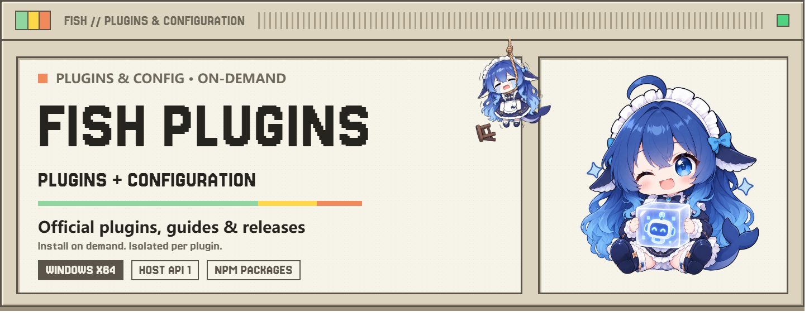
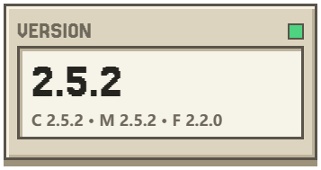
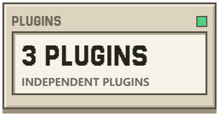
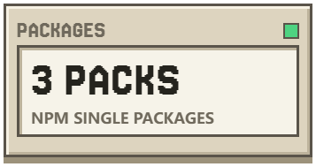
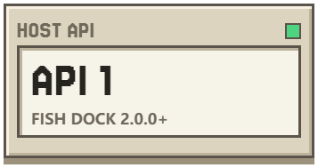
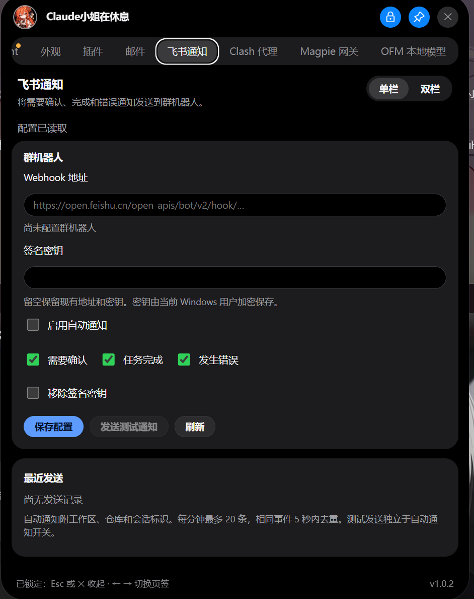
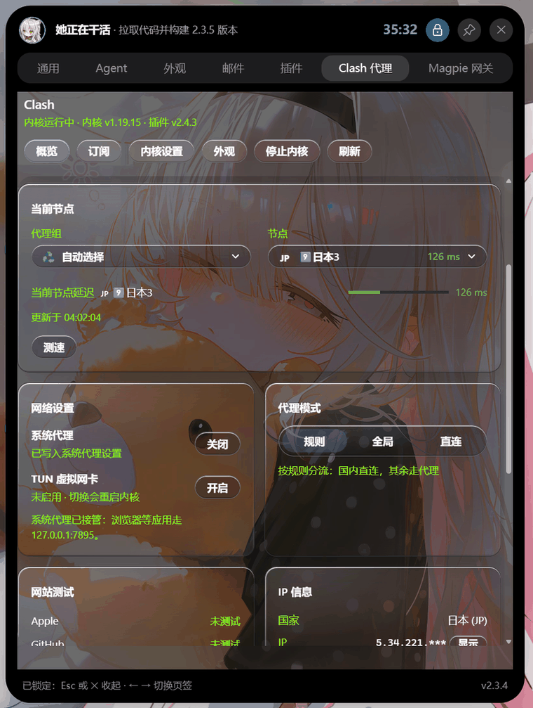
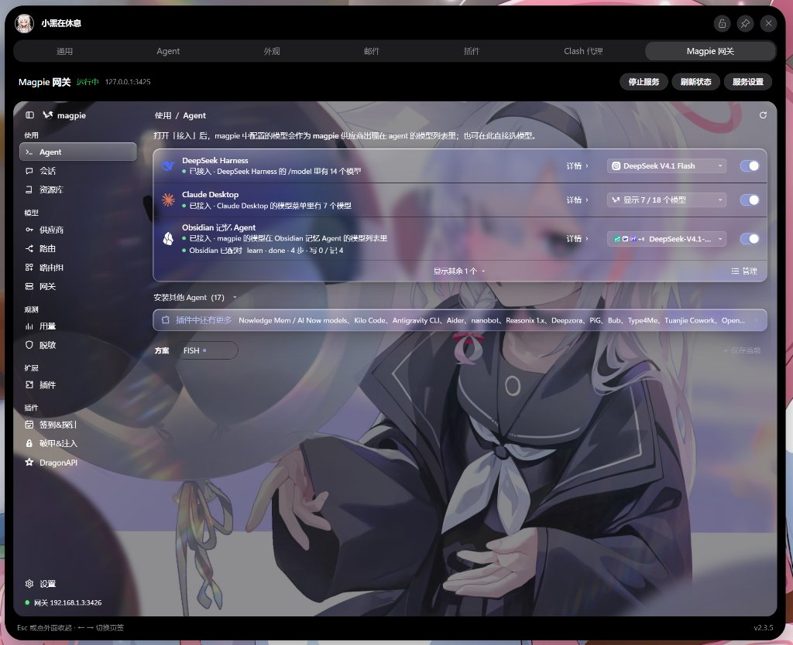

<div align="center">

<p>
  <a href="README.md"><picture><source media="(prefers-color-scheme: dark)" srcset="assets/readme/config-key-zh-en-dark.png"></picture></a>
  <a href="README.en.md"><picture><source media="(prefers-color-scheme: dark)" srcset="assets/readme/config-key-en-en-dark.png"></picture></a>
  <a href="docs/developers/README.md"><picture><source media="(prefers-color-scheme: dark)" srcset="assets/readme/config-key-start-en-dark.png"></picture></a>
</p>

<picture>
  <source media="(prefers-color-scheme: dark)" srcset="assets/readme/config-hero-en-dark.png">
  
</picture>

<p>
  <a href="https://github.com/Fish-under-sea/FISH-DOCK-Plugins/releases/tag/v2.5.2"><picture><source media="(prefers-color-scheme: dark)" srcset="assets/readme/config-stat-version-en-dark.png"></picture></a>
  <a href="#plugins"><picture><source media="(prefers-color-scheme: dark)" srcset="assets/readme/config-stat-desktop-en-dark.png"></picture></a>
  <a href="#packages"><picture><source media="(prefers-color-scheme: dark)" srcset="assets/readme/config-stat-mail-en-dark.png"></picture></a>
  <a href="https://github.com/Fish-under-sea/FISH-Dock"><picture><source media="(prefers-color-scheme: dark)" srcset="assets/readme/config-stat-channels-en-dark.png"></picture></a>
</p>

<p>    </p>
<p><strong>FISH Plugins &amp; Configuration</strong><br>Official FISH Dock plugins, configuration guides, and release packages; install on demand, isolated per plugin.</p>

<p>
  <a href="#get-started"><picture><source media="(prefers-color-scheme: dark)" srcset="assets/readme/config-key-download-en-dark.png"></picture></a>
  <a href="https://github.com/Fish-under-sea/FISH-DOCK-Plugins/releases/tag/v2.5.2"><picture><source media="(prefers-color-scheme: dark)" srcset="assets/readme/config-key-release-en-dark.png"></picture></a>
  <a href="https://github.com/Fish-under-sea/FISH-DOCK-Plugins/issues"><picture><source media="(prefers-color-scheme: dark)" srcset="assets/readme/config-key-issues-en-dark.png"></picture></a>
</p>

</div>

<h2 id="intro"><picture><source media="(prefers-color-scheme: dark)" srcset="assets/readme/section-intro-dark.png"></picture></h2>

This repository hosts the three official plugins for FISH Dock along with configuration guides, `.fish-plugin` archives, and release notes. Download standard `.fish-plugin` archives and import them on the Dock **Plugins** page, or fetch single-plugin archives from npm.

Each plugin stores its configuration and credentials in an isolated namespace, starts on demand, and never shares secrets across plugins. This repository publishes plugin packages only; desktop installers live in [FISH-Dock](https://github.com/Fish-under-sea/FISH-Dock).

Current release (`catalog/stable.json` is the single source of truth): Clash **2.5.2** (bundles mihomo 1.19.34, requires FISH Dock ≥ 2.0.0), Magpie **2.5.2** (`v0.1.4709+fish.51`, requires FISH Dock ≥ 2.3.4), and Feishu **2.2.0**; see [2.5.2 Release Notes](docs/releases/2.5.2.md).

**Recent Releases** (showing the latest 3 releases; full history in [Release Notes](docs/releases) and [GitHub Releases](https://github.com/Fish-under-sea/FISH-DOCK-Plugins/releases))

- **2.5.2** · Joint release: Magpie (`v0.1.4709+fish.51`) catches up with upstream and refreshes 165 liquid-glass surface rules; Clash hardens the Windows TUN service (wall-clock 15s host grace, 25s power-resume grace, `sc.exe` transient `unknown` protection, SHA-256-verified managed kernel copy under `ProgramData` avoiding UAC reinstalls on upgrades, lightweight `schtasks` watchdog stop, and redacted `tmp/mihomo.log`) and aligns runtime speed/config with Clash Verge (fast DNS, `gvisor` default stack, optional `strict-route`, auto `DELETE /connections` on switch, and safe allowlisted native single-subscription YAML merge). → [Notes](docs/releases/2.5.2.md)
- **2.5.1** · Clash patch release: fixes `mihomo v1.19+` `proxy-providers` latency test timeouts (merges `/providers/proxies` and routes checks through `healthcheck`), defaults `envProxy` to `tun.enable` with automatic restore across TUN switches/uninstall/stop/service exits, and redesigns the Overview Network Settings alignment plus Proxy Mode live routing card. → [Notes](docs/releases/2.5.1.md)
- **2.5.0** · Magpie (`v0.1.4650+fish.50`) catches up with upstream and refreshes 165 liquid-glass surface rules, adds Dock glass/font "Follow" hook integration, makes the top service bar transparent in glass mode, and stops accent color from tinting glass panels; Clash upgrades bundled mihomo to `v1.19.34`, adds an explicit user environment-proxy toggle (`HTTP_PROXY` / `HTTPS_PROXY` / `NO_PROXY` with watchdog lease restore), connects Dock "Follow" glass/font modes, and adds separate dark-mode font colors. → [Notes](docs/releases/2.5.0.md)
- **2.4.9 and earlier** · See [Release Notes](docs/releases) and [GitHub Releases](https://github.com/Fish-under-sea/FISH-DOCK-Plugins/releases) (all historical release notes in `docs/releases/` remain intact).

> ⚠️ **2.0.0 is a breaking release**: Plugin manifests added the `behaviors` field. FISH Dock 1.2.3 and earlier reject unknown fields during manifest parsing. **Upgrade FISH Dock to 2.0.0+ first** before installing these plugins.

> ⚠️ `@fish-under-sea/fish-dock-plugin-clash@1.1.0` on npm was published in error (missing the 1.0.4 multi-subscription fix) and should not be used. Current npm single packages are `2.5.2` for Clash, `2.5.2` for Magpie, `2.2.0` for Feishu, and `2.0.1` for OFM (retired).

<h2 id="plugins"><picture><source media="(prefers-color-scheme: dark)" srcset="assets/readme/section-features-dark.png"></picture></h2>

### Feishu Notifications

Feishu (Lark) group bot notification plugin supporting event filtering, message templates, and signature testing. Webhook URLs and signing secrets are stored in the plugin's encrypted credential store. Runs without a local daemon and displays "No autostart needed" on its Dock card. Authors: WTStarMark, FISH.

<p align="center"></p>

### Clash Proxy

Desktop proxy controller built on `mihomo` (`v1.19.34`) with bundled `GeoSite.dat` and `GeoIP.dat` rule databases. Supports multi-subscription validation and switching, proxy-group and node latency checks, Windows system-proxy and user environment-proxy (`HTTP_PROXY` / `HTTPS_PROXY` / `NO_PROXY`) lease management with self-healing watchdog, Windows TUN virtual adapter service management, and a dedicated Appearance page with 360° Fresnel liquid glass, Dock theme/glass follow, and separate dark-mode font colors. Binds strictly to loopback addresses. Authors: Elysia395, FISH.

<p align="center"></p>

### Magpie Gateway

Standalone multi-model API gateway and native desktop console for providers, API keys, smart routing groups, and usage analytics, paired with a built-in Obsidian Knowledge Vault Memory Agent connecting local coding agents. Admin UI, model gateway, and Dock embed proxy each run on dedicated loopback ports and share the Dock card's autostart switch. Supports four-region 360° Fresnel liquid glass, Dock theme/glass follow, custom wallpapers, and multi-level font tinting. Built-in extension pages ("Check-in & Relay Probe" and "Purge") are registered as npm specs and updated by Magpie itself. Authors: FISH, Jassdingk.

<p align="center"></p>

### OFM Local Models (Retired)

Local model channels and API workbench. **Maintenance paused on 2026-10-25 and removed from the Dock plugin catalog.** Still available for manual install from [GitHub Release](https://github.com/Fish-under-sea/FISH-DOCK-Plugins/releases/download/v2.0.1/ofm.fish-plugin) or npm (`2.0.1`). Existing installations keep working with data intact; new users should use Magpie Gateway. Author: FISH.

<h2 id="get-started"><picture><source media="(prefers-color-scheme: dark)" srcset="assets/readme/section-install-dark.png"></picture></h2>

Check your host version first: Clash 2.5.2 and Feishu 2.2.0 require **FISH Dock ≥ 2.0.0**, while Magpie 2.5.2 requires **FISH Dock ≥ 2.3.4**. Hosts on 1.2.3 or earlier reject the `behaviors` manifest field.

**Option 1: Dock Plugin Market (Recommended)**

1. Install [FISH Dock 2.0.0+](https://github.com/Fish-under-sea/FISH-Dock/releases).
2. Open **Plugins → Check Updates**: the official catalog (`catalog/stable.json`) lists all three plugins—select and confirm installation.
3. Verify status after install, then configure accounts or subscriptions on each plugin page.

**Option 2: npm Single Packages**

1. Run `npm install @fish-under-sea/fish-dock-plugin-<plugin>@<version>` (see the package table below).
2. Run `npx @fish-under-sea/fish-dock-plugin-<plugin> --out C:/work/plugins` to copy the SHA-256-verified `.fish-plugin` archive to a directory (refuses to overwrite existing files).
3. Import the `.fish-plugin` file on the Dock **Plugins** page.

| Plugin | GitHub Archive | npm Single Package |
| --- | --- | --- |
| Feishu 2.2.0 | [`feishu.fish-plugin`](https://github.com/Fish-under-sea/FISH-DOCK-Plugins/releases/download/v2.2.0/feishu.fish-plugin) | [`@fish-under-sea/fish-dock-plugin-feishu`](https://www.npmjs.com/package/@fish-under-sea/fish-dock-plugin-feishu/v/2.2.0) |
| Clash 2.5.2 | [`clash.fish-plugin`](https://github.com/Fish-under-sea/FISH-DOCK-Plugins/releases/download/v2.5.2/clash.fish-plugin) | [`@fish-under-sea/fish-dock-plugin-clash`](https://www.npmjs.com/package/@fish-under-sea/fish-dock-plugin-clash/v/2.5.2) |
| Magpie 2.5.2 | [`magpie.fish-plugin`](https://github.com/Fish-under-sea/FISH-DOCK-Plugins/releases/download/v2.5.2/magpie.fish-plugin) | [`@fish-under-sea/fish-dock-plugin-magpie`](https://www.npmjs.com/package/@fish-under-sea/fish-dock-plugin-magpie/v/2.5.2) |

<h2 id="packages"><picture><source media="(prefers-color-scheme: dark)" srcset="assets/readme/section-packages-dark.png"></picture></h2>

Each npm package contains a single verified `.fish-plugin` archive and its copy CLI (`fish-dock-plugin-<plugin>`), runs no postinstall scripts, and never touches Dock or OS settings. Requires **Node.js ≥ 24** and **FISH Dock ≥ 2.0.0**.

| npm Package | Version | CLI bin | `npm pack` Size |
| --- | --- | --- | --- |
| `@fish-under-sea/fish-dock-plugin-feishu` | 2.2.0 | `fish-dock-plugin-feishu` | 38.6 kB (6 files) |
| `@fish-under-sea/fish-dock-plugin-clash` | 2.5.2 | `fish-dock-plugin-clash` | 27.4 MB (7 files, incl. mihomo license) |
| `@fish-under-sea/fish-dock-plugin-magpie` | 2.5.2 | `fish-dock-plugin-magpie` | 55.9 MB (7 files, incl. Magpie license) |
| `@fish-under-sea/fish-dock-plugin-ofm` | 2.0.1 (retired, manual only) | `fish-dock-plugin-ofm` | 1.9 MB (6 files) |

```powershell
npm install @fish-under-sea/fish-dock-plugin-clash@2.5.2
npx @fish-under-sea/fish-dock-plugin-clash --out C:/work/plugins
```

Replace `clash` with `feishu` or `magpie` for the other plugins.

<h2 id="development"><picture><source media="(prefers-color-scheme: dark)" srcset="assets/readme/section-develop-dark.png"></picture></h2>

Requires Node.js 24 and the SDK from a sibling `FISH-Dock` checkout. Use separate output directories for dev staging, release archives, and npm packages.

```powershell
node tools/stage-development.mjs --out C:/work/preview-plugins --sdk ../FISH-Dock/sdk --magpie C:/work/runtimes/magpie.exe --mihomo C:/work/runtimes/mihomo.exe
node tools/build-release.mjs --out C:/work/release-2.5.0 --sdk ../FISH-Dock/sdk --magpie C:/work/runtimes/magpie.exe --mihomo C:/work/runtimes/mihomo.exe --version 2.5.0
node tools/build-npm-packages.mjs --dist C:/work/release-2.5.0/dist --out C:/work/npm-plugin-packages-2.5.0
node --test 'plugins/feishu/*.test.mjs' 'plugins/clash/*.test.mjs' 'plugins/magpie/*.test.mjs' 'shared/*.test.mjs' 'tools/*.test.mjs' 'plugins/magpie/obsidian-plugin/*.test.cjs'
```

### Documentation

Reference docs live alongside code (currently written in Chinese):

| Document | Scope |
| --- | --- |
| [Plugin Developer Guide](docs/developers/README.md) | Repo boundaries, `plugin.json` schema, backend/browser SDK, hooks, and declarations |
| [Liquid Glass & Theme Hook](docs/developers/liquid-glass-hooks.md) | CSS variables, state attributes, `FishDock.theme` & `magpie.onGlass` JS hooks, fallbacks |
| [External Native Window Hook](docs/developers/native-window-hook.md) | External native windows, `file-drop`, `dock` geometry, and host `dialogs` API |
| [Autostart Button Hook](docs/developers/autostart-hook.md) | `behaviors.autostart` and `FISH_PLUGIN_AUTOSTART=1` behavioral contract |
| [Plugin Maintainer Guide](docs/maintainers/README.md) | Identity table, pinned upstream runtimes, release workflow, and dev staging |
| [Self-Built Magpie Guide](plugins/magpie/tools/README.md) | Patch manifest, build commands, version tags, and upstream rebase notes |
| [Check-in & Relay Probe](https://github.com/Fish-under-sea/magpie-checkin-relay-probe) | Host read/call bridge, preinstalled plugin styling switch, and embedded logos |
| [Provider Logo Sources](https://github.com/Fish-under-sea/magpie-checkin-relay-probe/tree/main/page/checkin/logos) | Attribution, cropping, and licensing for each vendor asset |
| [Release Notes](docs/releases/) | Per-version changelogs and verification records; latest is [2.5.2](docs/releases/2.5.2.md) |
| [Third-Party Notices](THIRD_PARTY_NOTICES.md) | Licenses and checksums for bundled runtimes (mihomo GPL-3.0, Magpie MIT, etc.) |
| [README Header Maintenance](assets/readme/MAINTAINING.md) | Header rendering pipeline, typography constraints, and asset rules |

<h2 id="thanks"><picture><source media="(prefers-color-scheme: dark)" srcset="assets/readme/section-thanks-dark.png"></picture></h2>

These upstream projects power the plugins in this repository:

### [Magpie](https://github.com/yetone/magpie) · Model Gateway & Plugin Host

The foundation behind the Magpie plugin—provider registration, panel bridge, check-in/quota reading, and gateway routing all come from upstream. The `magpie.fish-plugin` archive bundles a **self-compiled build** from upstream tag `v0.1.4709` plus our cumulative patch `fish.51` (upstream catch-up, 165 refreshed glass surface rules, Dock glass/font follow hook, transparent top bar in glass mode, accent-decoupled glass panels, Obsidian Memory Agent, and `magpie.call` bridge). Full patch documentation lives in [plugins/magpie/tools/README.md](plugins/magpie/tools/README.md), with upstream attribution retained in `licenses/Magpie.txt`.

### [mihomo](https://github.com/MetaCubeX/mihomo) · Clash Core

The Clash plugin runs unmodified upstream `mihomo` (`v1.19.34`, GPL-3.0) Windows amd64 builds for routing, subscriptions, rules, and TUN; this repository provides only the Dock adapter and UI. The full license is bundled in `licenses/mihomo.txt`.

### [Our Free Model](https://github.com/Ebony-Vinyl/dsh-our-free-model) · OFM Base

OFM was built on Our Free Model's standalone server and channel layer. Maintenance paused on 2026-10-25; existing installs continue working with data preserved.

### License Boundary

The adapter code and release tooling in this repository are MIT-licensed. Release archives bundle third-party runtimes under their own licenses—refer to [THIRD_PARTY_NOTICES.md](THIRD_PARTY_NOTICES.md) and each archive's `licenses/` directory for full terms.

<p align="center"><sub>FISH Dock Official Plugins · Independent packages · Host API 1</sub></p>
