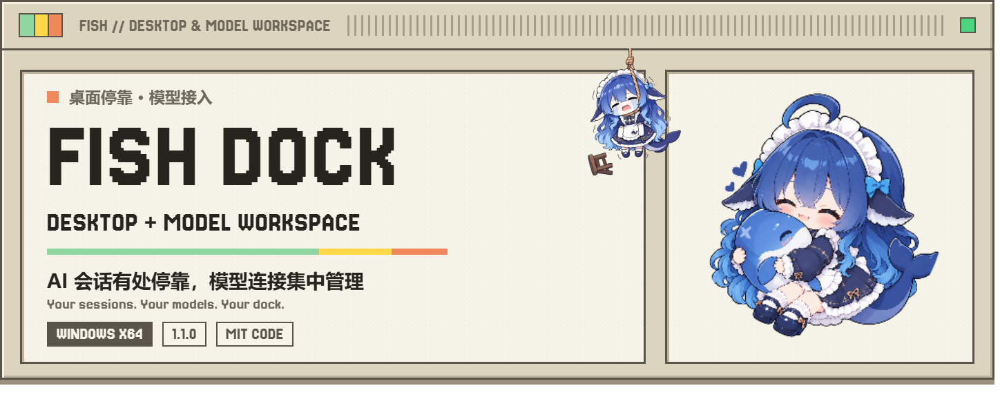
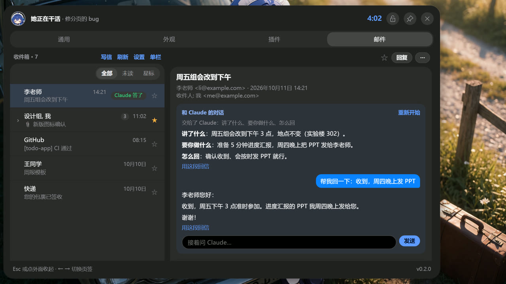

<p align="center">
  <a href="README.md"></a>
  <a href="https://github.com/Fish-under-sea/FISH-Dock/blob/main/README.en.md"></a>
  <a href="#安装与更新"></a>
</p>

<picture>
  <source media="(prefers-color-scheme: dark)" srcset="assets/readme/hero-zh-dark.png">
  
</picture>

<p align="center">
  <a href="https://github.com/Fish-under-sea/FISH-DOCK-Plugins/releases/tag/v1.0.0"></a>
  <a href="https://github.com/Fish-under-sea/FISH-DOCK-Plugins/releases/tag/v1.0.0"></a>
  <a href="https://github.com/Fish-under-sea/FISH-DOCK-Plugins/issues"></a>
</p>

<p align="center"><strong>Everything is a Plugin · 一切皆插件</strong><br>四个独立插件，按需安装、按需启动，桌面宿主负责生命周期和数据边界。</p>

<table>
  <tr>
    <td width="25%"><strong>VERSION</strong><br><code>1.0.0</code><br>插件发行</td>
    <td width="25%"><strong>PLUGINS</strong><br><code>4</code><br>独立安装包</td>
    <td width="25%"><strong>NPM</strong><br><code>4</code><br>独立单包</td>
    <td width="25%"><strong>API</strong><br><code>1</code><br>宿主接口</td>
  </tr>
</table>

<table>
  <tr>
    <td><strong>INDEX</strong><br><strong>目录</strong></td>
    <td><a href="#安装与更新">安装与更新</a> · <a href="#四个插件">四个插件</a> · <a href="#npm-单包">npm 单包</a><br><a href="#界面预览">界面预览</a> · <a href="#开发与验证">开发与验证</a> · <a href="#来源和许可">来源和许可</a></td>
  </tr>
</table>

## 安装与更新

1. 安装 [FISH Dock 1.1.0](https://github.com/Fish-under-sea/FISH-Dock/releases/tag/v1.1.0)。
2. 打开「插件」页，刷新官方商店，选择需要的插件并确认安装。
3. 也可以从 [GitHub Release](https://github.com/Fish-under-sea/FISH-DOCK-Plugins/releases/tag/v1.0.0) 下载对应 `.fish-plugin`，对照 `SHA256SUMS.txt` 后在「插件」页导入。

插件包是标准 ZIP，根内包含 `plugin.json` 和资源。下载或导入不会启动服务。飞书需要填写 Webhook；Clash 需要导入订阅；Magpie 和 OFM 默认停止，在各自页面保存配置后手动启动。

## 四个插件

<table>
  <tr>
    <td width="25%"><strong>飞书</strong><br>群机器人通知<br>事件筛选与签名</td>
    <td width="25%"><strong>Clash</strong><br>mihomo 内核<br>订阅、节点与代理</td>
    <td width="25%"><strong>Magpie</strong><br>独立模型网关<br>原生管理页</td>
    <td width="25%"><strong>OFM（灰度）</strong><br>渠道账号<br>模型目录与 API</td>
  </tr>
</table>

| 插件 | GitHub 包 | npm 单包 |
| --- | --- | --- |
| 飞书 | [`feishu.fish-plugin`](https://github.com/Fish-under-sea/FISH-DOCK-Plugins/releases/download/v1.0.0/feishu.fish-plugin) | [`@fish-under-sea/fish-dock-plugin-feishu`](https://www.npmjs.com/package/@fish-under-sea/fish-dock-plugin-feishu/v/1.0.0) |
| Clash | [`clash.fish-plugin`](https://github.com/Fish-under-sea/FISH-DOCK-Plugins/releases/download/v1.0.0/clash.fish-plugin) | [`@fish-under-sea/fish-dock-plugin-clash`](https://www.npmjs.com/package/@fish-under-sea/fish-dock-plugin-clash/v/1.0.0) |
| Magpie | [`magpie.fish-plugin`](https://github.com/Fish-under-sea/FISH-DOCK-Plugins/releases/download/v1.0.0/magpie.fish-plugin) | [`@fish-under-sea/fish-dock-plugin-magpie`](https://www.npmjs.com/package/@fish-under-sea/fish-dock-plugin-magpie/v/1.0.0) |
| OFM | [`ofm.fish-plugin`](https://github.com/Fish-under-sea/FISH-DOCK-Plugins/releases/download/v1.0.0/ofm.fish-plugin) | [`@fish-under-sea/fish-dock-plugin-ofm`](https://www.npmjs.com/package/@fish-under-sea/fish-dock-plugin-ofm/v/1.0.0) |

### 界面预览

<table>
  <tr>
    <td width="50%"></td>
    <td width="50%"></td>
  </tr>
  <tr>
    <td align="center"><strong>宿主插件中心</strong></td>
    <td align="center"><strong>模型渠道工作台</strong></td>
  </tr>
  <tr>
    <td width="50%"></td>
    <td width="50%"></td>
  </tr>
  <tr>
    <td align="center"><strong>邮件与单双栏布局</strong></td>
    <td align="center"><strong>桌面岛状态</strong></td>
  </tr>
</table>

> OFM 目前仅属于灰度测试，暂时不可使用。其界面和源码随插件保留，当前版本暂未开放可用的登录、项目绑定及模型调用。

## npm 单包

四个 npm 包分别提供一个已校验的对应插件归档和安装命令。不会运行安装后脚本，也不会修改 Dock、系统代理或其他系统设置。

| npm 包 | 安装命令 |
| --- | --- |
| `@fish-under-sea/fish-dock-plugin-feishu` | `npx @fish-under-sea/fish-dock-plugin-feishu --out C:/work/plugins` |
| `@fish-under-sea/fish-dock-plugin-clash` | `npx @fish-under-sea/fish-dock-plugin-clash --out C:/work/plugins` |
| `@fish-under-sea/fish-dock-plugin-magpie` | `npx @fish-under-sea/fish-dock-plugin-magpie --out C:/work/plugins` |
| `@fish-under-sea/fish-dock-plugin-ofm` | `npx @fish-under-sea/fish-dock-plugin-ofm --out C:/work/plugins` |

示例：

```powershell
npm install @fish-under-sea/fish-dock-plugin-magpie@1.0.0
npx @fish-under-sea/fish-dock-plugin-magpie --out C:/work/plugins
```

命令会校验 npm 包内归档的 SHA-256，并使用新文件方式写入目标目录；目标文件已存在时停止，避免覆盖已有版本。

## 数据与宿主边界

插件服务、凭据、配置和数据互相独立。宿主启动时解析完整数据根：`--data-root` → `FISH_DOCK_HOME` → 当前用户目录下 `.fish-dock`。

| 归属 | 根内目录 |
| --- | --- |
| 宿主 | `host` |
| OFM | `.fishplugin-ourfreemodel` |
| 飞书 | `.fishplugin-feishu` |
| Clash | `.fishplugin-clash` |
| Magpie | `.fishplugin-magpie` |
| 第三方插件 | `.plugin.<publisher>.<name>` |

各目录按 `credentials`、`roster`、`keys`、`config`、`exports`、`backups`、`tmp` 分类。备份可能包含账号和密钥，请作为个人资料保存。独立进程是生命周期边界，不等于操作系统权限隔离。

## 开发与验证

需要 Node.js 24 和相邻 Dock 仓的 SDK。开发暂存与正式发行采用不同输出目录，原生服务由开发者明确提供。

```powershell
node tools/stage-development.mjs --out C:/work/preview-plugins --sdk ../FISH-Dock/sdk --ofm ../FISH-Dock/dsh-our-free-model --magpie C:/work/runtimes/magpie.exe --mihomo C:/work/runtimes/mihomo.exe
node tools/build-release.mjs --out C:/work/release-1.0.0 --sdk ../FISH-Dock/sdk --ofm ../FISH-Dock/dsh-our-free-model --magpie C:/work/runtimes/magpie.exe --mihomo C:/work/runtimes/mihomo.exe
node tools/build-npm-packages.mjs --dist C:/work/release-1.0.0/dist --out C:/work/npm-plugin-packages-1.0.0
node --test --test-isolation=none 'plugins/feishu/*.test.mjs' 'plugins/clash/*.test.mjs' 'plugins/magpie/*.test.mjs' 'plugins/ofm/*.test.mjs' 'shared/*.test.mjs' 'tools/*.test.mjs'
```

每个 npm 单包位于输出目录的对应子目录，进入该目录执行 `npm publish --access public`。发布前使用 `npm pack --dry-run` 检查文件清单，不把其他插件、用户数据或构建缓存带入包内。

## 来源和许可

适配代码采用 MIT。Clash 使用 [mihomo](https://github.com/MetaCubeX/mihomo) v1.19.15，Magpie 使用 [Magpie](https://github.com/yetone/magpie) 固定 Windows 资源，OFM 基于 [Our Free Model](https://github.com/Ebony-Vinyl/dsh-our-free-model) 的 standalone 构建与渠道能力。

第三方版权、许可证原文和固定资源摘要见 [THIRD_PARTY_NOTICES.md](THIRD_PARTY_NOTICES.md) 及各 npm 单包内的 `licenses` 目录。

<p align="center"><sub>FISH Dock Official Plugins · Four independent packages · Host API 1</sub></p>
