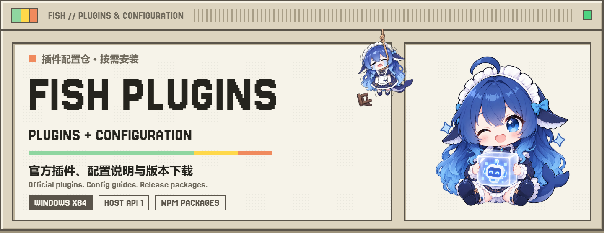
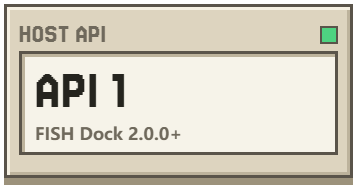
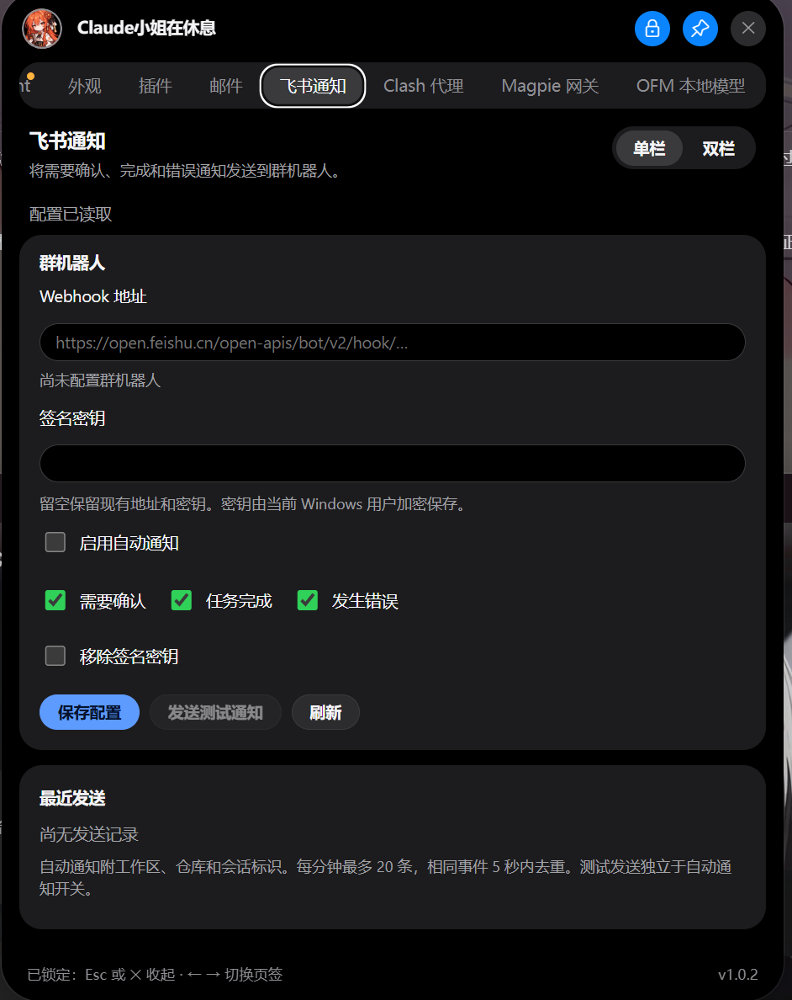
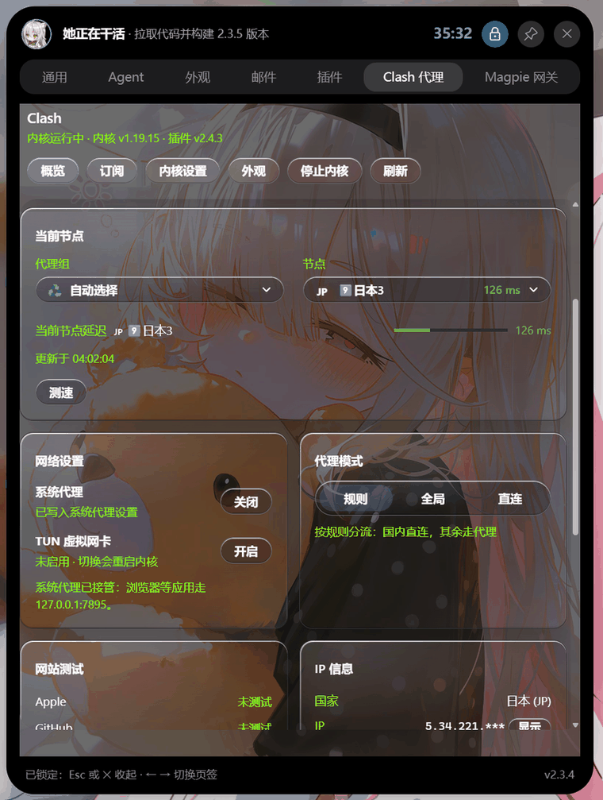
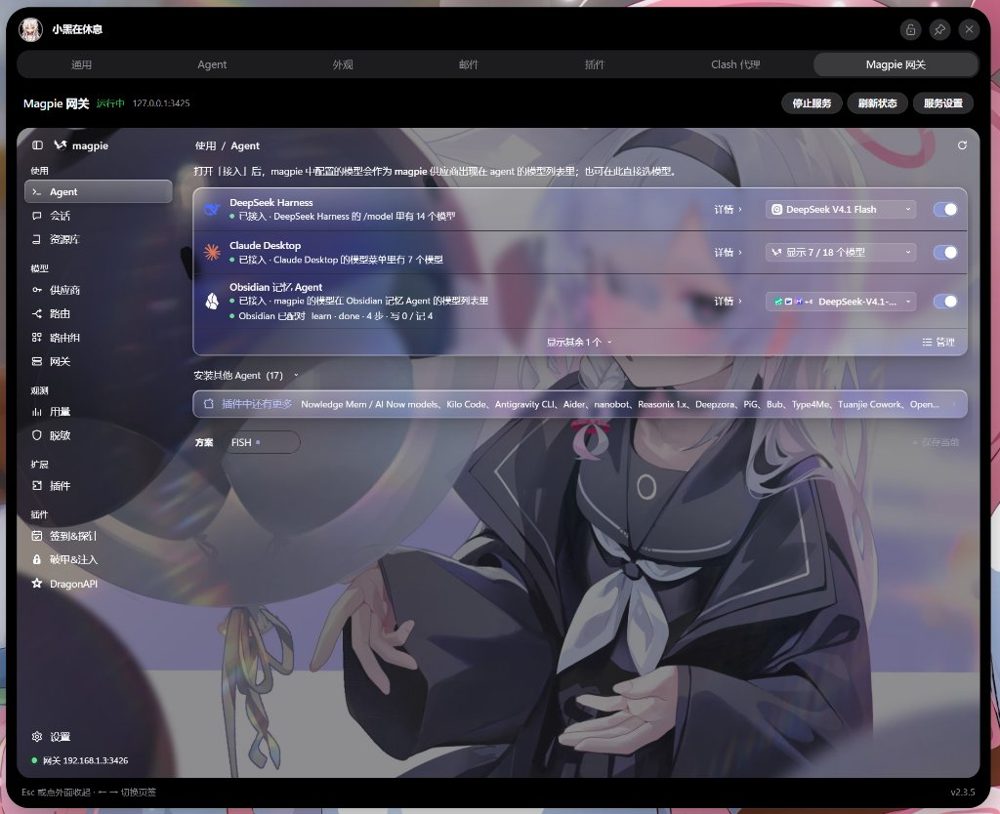

<div align="center">

<p>
  <a href="README.md"><picture><source media="(prefers-color-scheme: dark)" srcset="assets/readme/key-zh-zh-dark.png"></picture></a>
  <a href="https://github.com/Fish-under-sea/FISH-Dock/blob/main/README.en.md"><picture><source media="(prefers-color-scheme: dark)" srcset="assets/readme/key-en-zh-dark.png"></picture></a>
  <a href="docs/developers/README.md"><picture><source media="(prefers-color-scheme: dark)" srcset="assets/readme/key-start-zh-dark.png"></picture></a>
</p>

<picture>
  <source media="(prefers-color-scheme: dark)" srcset="assets/readme/config-hero-zh-dark.png">
  
</picture>

<p>
  <a href="https://github.com/Fish-under-sea/FISH-DOCK-Plugins/releases/tag/v2.4.5"><picture><source media="(prefers-color-scheme: dark)" srcset="assets/readme/config-stat-version-zh-dark.png"></picture></a>
  <a href="#plugins"><picture><source media="(prefers-color-scheme: dark)" srcset="assets/readme/config-stat-desktop-zh-dark.png"></picture></a>
  <a href="#packages"><picture><source media="(prefers-color-scheme: dark)" srcset="assets/readme/config-stat-mail-zh-dark.png"></picture></a>
  <a href="https://github.com/Fish-under-sea/FISH-Dock"><picture><source media="(prefers-color-scheme: dark)" srcset="assets/readme/config-stat-channels-zh-dark.png"></picture></a>
</p>

<p>   </p>
<p><strong>FISH Plugins &amp; Configuration · 插件配置仓</strong><br>官方插件、配置说明与发行入口；按需安装，独立运行。</p>

<p>
  <a href="#get-started"><picture><source media="(prefers-color-scheme: dark)" srcset="assets/readme/key-download-zh-dark.png"></picture></a>
  <a href="https://github.com/Fish-under-sea/FISH-DOCK-Plugins/releases/tag/v2.4.5"><picture><source media="(prefers-color-scheme: dark)" srcset="assets/readme/key-release-zh-dark.png"></picture></a>
  <a href="https://github.com/Fish-under-sea/FISH-DOCK-Plugins/issues"><picture><source media="(prefers-color-scheme: dark)" srcset="assets/readme/key-issues-zh-dark.png"></picture></a>
</p>

</div>

<h2 id="intro"><picture><source media="(prefers-color-scheme: dark)" srcset="assets/readme/section-intro-dark.png"></picture></h2>

这里是 FISH Dock 的插件配置仓，集中提供三个官方插件的功能介绍、配置说明、安装包和更新记录。下载标准 `.fish-plugin` 包后，可在 Dock 的「插件」页导入；也可以通过 npm 获取对应插件归档。

每个插件独立保存配置与凭据，按需启动，不共享业务密钥。插件仓只发布插件资源，桌面安装包请前往 [FISH-Dock](https://github.com/Fish-under-sea/FISH-Dock)。

当前发行（以 `catalog/stable.json` 为唯一权威）：Magpie **2.4.5**（原生标识 `v0.1.4262+fish.45`，要求 FISH Dock ≥ 2.3.4）、Clash **2.4.5**、飞书 **2.2.0**。本版详见 [2.4.5 发行说明](docs/releases/2.4.5.md)（Obsidian 记忆 Agent、液态玻璃表面补全与颜色解耦、Clash TUN 服务与切换及液态玻璃修复）；外观分页与初版记忆 Agent 见 [2.4.0 发行说明](docs/releases/2.4.0.md)。

**最近版本**（当前 2.4.5；每一版的完整说明见 [docs/releases](docs/releases)）

- **2.4.5** · Magpie：Obsidian 记忆功能纳入 `.obsidian` 统一工作区正式 Agent（`fish.45`）；用量四页签等 159 条液态玻璃表面规则与独立玻璃颜色（`fishGlassColor`）解耦强调色，修复侧边栏真全透与零滤镜（`fish.44`）。Clash：TUN 服务恢复（`job.ini` 监听/BOM 剥离/`hostGone`）与切换回滚修复，对齐 360° Fresnel 液态玻璃、滚动条/过滤框与下拉交互。→ [说明](docs/releases/2.4.5.md)
- **2.4.4** · Magpie：外观页签图标补齐；底图遮挡改为 `--wall-veil` 并在滑块松手后重画，从此真正生效；回滚改坏的侧栏内滚；玻璃覆盖改由 `tools/glass-surfaces.mjs` 从 `app.css` 生成。Clash：适配宿主页桥 2 MiB 上限，壁纸预算 1.5 MiB，超限不再假死。→ [说明](docs/releases/2.4.4.md)
- **2.4.3** · Clash 外观页一卡一行、浮空白色滚动条、壁纸自动压缩；Magpie 侧边栏与外观页秩序。→ [说明](docs/releases/2.4.3.md)
- **2.4.2** · 玻璃可读性：壁纸遮罩随内容区不透明度；Clash 外观页细节修正。→ [说明](docs/releases/2.4.2.md)
- **2.4.1** · Clash 外观页保存条与下拉定位。→ [说明](docs/releases/2.4.1.md)
- **2.4.0** · 外观独立成页、液态玻璃改四区域调节、Clash 也有外观设置；Magpie 内置记忆 Agent。→ [说明](docs/releases/2.4.0.md)
- **2.3.9 / 2.3.8 / 2.3.7** · 修复 2.3.8 无法启动；Obsidian 窗口与提示；跟进上游与独立共享知识库。→ [2.3.9](docs/releases/2.3.9.md) · [2.3.8](docs/releases/2.3.8.md) · [2.3.7](docs/releases/2.3.7.md)
- **2.2.x 及更早** · 见 [docs/releases](docs/releases)。

> ⚠️ **2.0.0 是 breaking 版本**：插件清单新增 `behaviors` 字段，FISH Dock 1.2.3 及更早的宿主用 `deny_unknown_fields` 解析，会以「plugin.json 格式无效或含未知字段」直接拒装。**旧宿主请先把 Dock 升到 2.0.0**，再安装这些插件。

> ⚠️ npm 上 `@fish-under-sea/fish-dock-plugin-clash@1.1.0` 为误发版本（基于旧基线，缺少 1.0.4 的多订阅修复），请勿使用；当前 Magpie 单包是 `2.4.5`、Clash 是 `2.4.5`、飞书是 `2.2.0`，OFM 停在 `2.0.1`（已退役）。

<h2 id="plugins"><picture><source media="(prefers-color-scheme: dark)" srcset="assets/readme/section-features-dark.png"></picture></h2>

### 飞书通知

群机器人通知、事件筛选和签名配置。Webhook 与签名密钥保存在插件自己的加密凭据空间。作者：WTStarMark、FISH。没有本机服务，插件卡上显示「无需自启动」。

<p align="center"></p>

### Clash 代理

基于 mihomo 的代理管理，提供订阅、节点、规则和系统代理控制。代理内核只绑定回环地址。作者：Elysia395、FISH。

<p align="center"></p>

### Magpie 网关

独立模型网关与原生管理页。管理页、模型网关和 Dock 嵌入代理使用独立回环端口，避免相互占用。网关页与服务页共用一颗「自启动」胶囊，决定服务是否随 Dock 启动；插件卡上是同一份状态。签到页随包内置，按厂商分组、支持一键签到与积分刷新。作者：FISH、Jassdingk。

<p align="center"></p>

### OFM 本地模型（不再随 Dock 显示）

本地模型渠道和 API 工作台。**自 2026 年 10 月 25 日起暂停维护，也不再在 Dock 的插件页里出现**——需要的从 [GitHub Release](https://github.com/Fish-under-sea/FISH-DOCK-Plugins/releases/download/v2.0.1/ofm.fish-plugin) 或 npm 手动装（版本停在 `2.0.1`）。已经装好的版本可以继续用，配置与数据保留；要模型网关请迁移到 Magpie。作者：FISH。

<h2 id="get-started"><picture><source media="(prefers-color-scheme: dark)" srcset="assets/readme/section-install-dark.png"></picture></h2>

安装前先核对宿主版本：Magpie 是 2.4.5（要求 FISH Dock ≥ 2.3.4）、Clash 是 2.4.5、飞书是 2.2.0，**FISH Dock 需要 2.0.0 及以上**；1.2.3 及更早的宿主会因清单里的 `behaviors` 字段拒装。

**方式一：Dock 内插件市场（推荐）**

1. 安装 [FISH Dock 2.0.0](https://github.com/Fish-under-sea/FISH-Dock/releases/tag/v2.0.0)。
2. 打开「插件」页 →「检查更新」：官方目录（本仓 `catalog/stable.json`）会列出这三个插件，勾选后确认安装。
3. 安装后确认运行状态；需要账号或订阅的插件，再进入对应页面完成配置。

**方式二：npm 单包**

1. `npm install @fish-under-sea/fish-dock-plugin-<插件>@<版本>`（三个包名与各包当前版本见下方「npm 单包」一节）。
2. `npx @fish-under-sea/fish-dock-plugin-<插件> --out C:/work/plugins`：把已校验的 `.fish-plugin` 复制到指定目录；目标已存在同名文件时命令会停下，不覆盖。
3. 在 Dock 的「插件」页导入该 `.fish-plugin`，其余同方式一。

下表给出三个插件对应的 GitHub 包与 npm 单包；GitHub 链接指向各自当前 Release tag。OFM 不在表里——它已退役，只在上面那一节的手动下载入口里。

| 插件 | GitHub 包 | npm 单包 |
| --- | --- | --- |
| 飞书 2.2.0 | [`feishu.fish-plugin`](https://github.com/Fish-under-sea/FISH-DOCK-Plugins/releases/download/v2.2.0/feishu.fish-plugin) | [`@fish-under-sea/fish-dock-plugin-feishu`](https://www.npmjs.com/package/@fish-under-sea/fish-dock-plugin-feishu/v/2.2.0) |
| Clash 2.4.5 | [`clash.fish-plugin`](https://github.com/Fish-under-sea/FISH-DOCK-Plugins/releases/download/v2.4.5/clash.fish-plugin) | [`@fish-under-sea/fish-dock-plugin-clash`](https://www.npmjs.com/package/@fish-under-sea/fish-dock-plugin-clash/v/2.4.5) |
| Magpie 2.4.5 | [`magpie.fish-plugin`](https://github.com/Fish-under-sea/FISH-DOCK-Plugins/releases/download/v2.4.5/magpie.fish-plugin) | [`@fish-under-sea/fish-dock-plugin-magpie`](https://www.npmjs.com/package/@fish-under-sea/fish-dock-plugin-magpie/v/2.4.5) |

<h2 id="packages"><picture><source media="(prefers-color-scheme: dark)" srcset="assets/readme/section-packages-dark.png"></picture></h2>

每个 npm 包只包含一个对应的插件归档和下载 CLI（bin 名 `fish-dock-plugin-<插件>`），不运行安装后脚本，不修改 Dock 或系统设置。当前 npm 上 **Magpie 是 2.4.5、Clash 是 2.4.5、飞书是 2.2.0**（OFM 单包停在 2.0.1，已退役只供手动下载），要求 **Node.js ≥ 24** 与 **FISH Dock ≥ 2.0.0**。

| npm 单包（完整包名） | 版本 | bin | `npm pack` 体积 |
| --- | --- | --- | --- |
| `@fish-under-sea/fish-dock-plugin-feishu` | 2.2.0 | `fish-dock-plugin-feishu` | 38.6 kB（6 个文件） |
| `@fish-under-sea/fish-dock-plugin-clash` | 2.4.5 | `fish-dock-plugin-clash` | 16.9 MB（7 个文件，含 mihomo 许可） |
| `@fish-under-sea/fish-dock-plugin-magpie` | 2.4.5 | `fish-dock-plugin-magpie` | 49.0 MB（7 个文件，含 Magpie 许可） |
| `@fish-under-sea/fish-dock-plugin-ofm` | 2.0.1（暂停维护，仅手动） | `fish-dock-plugin-ofm` | 1.9 MB（6 个文件） |

```powershell
npm install @fish-under-sea/fish-dock-plugin-clash@2.4.5
npx @fish-under-sea/fish-dock-plugin-clash --out C:/work/plugins
```

`--out` 只接收一个目录：命令把已校验的 `clash.fish-plugin`（按 SHA-256 与包内记录比对）复制进去；目标已存在同名文件时直接停下，不覆盖。复制完在 Dock 的「插件」页导入即可。三个包名分别是 `feishu`、`clash`、`magpie`，把上例里的 `clash` 换成对应名字即可。

<h2 id="development"><picture><source media="(prefers-color-scheme: dark)" srcset="assets/readme/section-develop-dark.png"></picture></h2>

需要 Node.js 24 和相邻 Dock 仓的 SDK。开发暂存、正式插件包和 npm 单包使用不同输出目录。

```powershell
node tools/stage-development.mjs --out C:/work/preview-plugins --sdk ../FISH-Dock/sdk --magpie C:/work/runtimes/magpie.exe --mihomo C:/work/runtimes/mihomo.exe
node tools/build-release.mjs --out C:/work/release-2.4.0 --sdk ../FISH-Dock/sdk --magpie C:/work/runtimes/magpie.exe --mihomo C:/work/runtimes/mihomo.exe --version 2.4.0
node tools/build-npm-packages.mjs --dist C:/work/release-2.4.0/dist --out C:/work/npm-plugin-packages-2.4.0
node --test --test-isolation=none 'plugins/feishu/*.test.mjs' 'plugins/clash/*.test.mjs' 'plugins/magpie/*.test.mjs' 'shared/*.test.mjs' 'tools/*.test.mjs'
```

### 文档

写插件、改插件、发版之前先看这几份，它们跟着代码一起改：

| 文档 | 讲什么 |
| --- | --- |
| [插件开发者指南](docs/developers/README.md) | 仓库边界、`plugin.json` 的字段、后台 SDK 与页面、行为钩子、读与调用的声明 |
| [插件维护者指南](docs/maintainers/README.md) | 身份表（作者与状态说明只在一处维护）、固定来源与资源、发行流程、开发暂存 |
| [自编译 Magpie](plugins/magpie/tools/README.md) | 补丁清单与每一处为什么补、构建命令、版本标识、跟着上游升级时会踩的坑 |
| [签到&探针说明](https://github.com/Fish-under-sea/magpie-checkin-relay-probe) | 宿主提供哪些读与调用、「预装插件美化」开关怎么工作、素材为什么编进 exe |
| [厂商素材来源](https://github.com/Fish-under-sea/magpie-checkin-relay-probe/tree/main/page/checkin/logos) | 每张厂商图的来源、裁切范围与授权状况 |
| [发行说明](docs/releases/) | 逐版本的改动与验证；最新是 [2.4.5](docs/releases/2.4.5.md) |
| [第三方许可](THIRD_PARTY_NOTICES.md) | 随包运行时的许可与来源（mihomo 的 GPL-3.0、Magpie 的随包许可等） |
| [README 头图维护](assets/readme/MAINTAINING.md) | 头图怎么渲染、字号与卡片尺寸的约束、哪些东西不能换 |

新增插件或改了行为，**先改对应的那份文档，再发版**——上面的链接都不允许指向一份过期的说明。

<h2 id="thanks"><picture><source media="(prefers-color-scheme: dark)" srcset="assets/readme/section-thanks-dark.png"></picture></h2>

这三个上游各自撑起了本仓的一部分。**没有它们，这里的插件只是几个空壳**——按分量排，依次是：

### [Magpie](https://github.com/yetone/magpie) · 模型网关与插件宿主

整个 Magpie 插件的地基。供应商注册、页面与面板桥、签到与额度读取、网关路由，全部是上游的代码；本仓写着「Magpie 插件」的那层，实际上只是它的适配层、页面与发布工具。

本仓发布的 `magpie.fish-plugin` 走的是**其源码自编译**：基线上游 tag（当前 `v0.1.4262`），加上 `patches/` 里我们自己的累计补丁（当前累计至 `fish.45`：页面在 CSP 沙箱里发不出任何请求，所以补一条 `magpie.call` 通道，并陆续补入本地素材接管、液态玻璃适配与 Obsidian 记忆 Agent 等增强）。补丁的每一处、为什么补、怎么复现，都写在 [plugins/magpie/tools/README.md](plugins/magpie/tools/README.md) 里。上游的版本标识与第三方声明随包保留（`licenses/Magpie.txt`）。

### [mihomo](https://github.com/MetaCubeX/mihomo) · Clash 内核

Clash 插件的内核是 mihomo，GPL-3.0 许可。节点、订阅、规则、TUN，真正干活的是它；本仓只写适配层与页面，内核一行没改。发行包里带的是官方 release 的 Windows amd64 构建，`licenses/mihomo.txt` 是它随包的许可证全文，源码与构建方式见上游仓库。

### [Our Free Model](https://github.com/Ebony-Vinyl/dsh-our-free-model) · OFM 的底座

OFM 基于 Our Free Model 的 standalone 构建与渠道能力。该插件自 2026 年 10 月 25 日起暂停维护，已经装好的版本继续可用，配置与数据保留。

### 许可证边界

本仓的插件适配层与发布工具采用 MIT。发行包同时包含上面这些第三方运行时，所以「适配层 MIT」不等于「包含的全部二进制均为 MIT」：以 [THIRD_PARTY_NOTICES.md](THIRD_PARTY_NOTICES.md) 和各插件包内的 `licenses` 目录为准。

<p align="center"><sub>FISH Dock Official Plugins · Four independent packages · Host API 1</sub></p>

