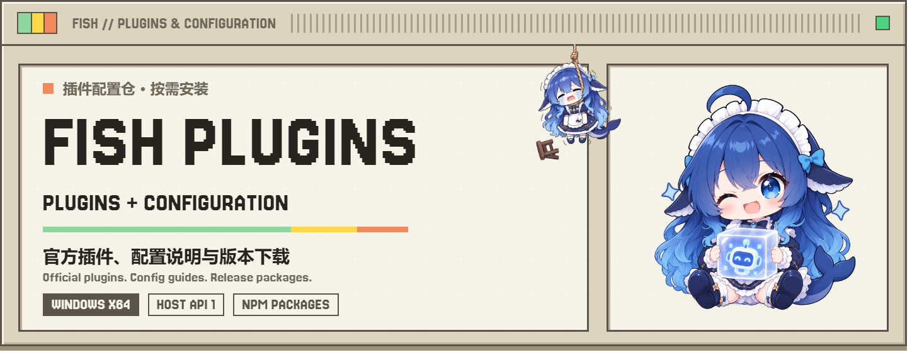
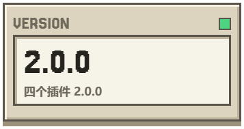
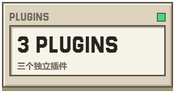
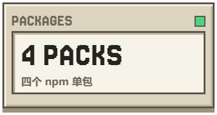
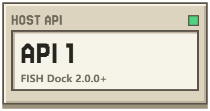

<div align="center">

<p>
  <a href="README.md"><picture><source media="(prefers-color-scheme: dark)" srcset="assets/readme/key-zh-zh-dark.png"></picture></a>
  <a href="https://github.com/Fish-under-sea/FISH-Dock/blob/main/README.en.md"><picture><source media="(prefers-color-scheme: dark)" srcset="assets/readme/key-en-zh-dark.png"></picture></a>
  <a href="#get-started"><picture><source media="(prefers-color-scheme: dark)" srcset="assets/readme/key-start-zh-dark.png"></picture></a>
</p>

<picture>
  <source media="(prefers-color-scheme: dark)" srcset="assets/readme/config-hero-zh-dark.png">
  
</picture>

<p>
  <a href="https://github.com/Fish-under-sea/FISH-DOCK-Plugins/releases/tag/v2.0.0"><picture><source media="(prefers-color-scheme: dark)" srcset="assets/readme/config-stat-version-zh-dark.png"></picture></a>
  <a href="#plugins"><picture><source media="(prefers-color-scheme: dark)" srcset="assets/readme/config-stat-desktop-zh-dark.png"></picture></a>
  <a href="#packages"><picture><source media="(prefers-color-scheme: dark)" srcset="assets/readme/config-stat-mail-zh-dark.png"></picture></a>
  <a href="https://github.com/Fish-under-sea/FISH-Dock"><picture><source media="(prefers-color-scheme: dark)" srcset="assets/readme/config-stat-channels-zh-dark.png"></picture></a>
</p>

<p>   </p>
<p><strong>FISH Plugins &amp; Configuration · 插件配置仓</strong><br>官方插件、配置说明与发行入口；按需安装，独立运行。</p>

<p>
  <a href="#get-started"><picture><source media="(prefers-color-scheme: dark)" srcset="assets/readme/key-download-zh-dark.png"></picture></a>
  <a href="https://github.com/Fish-under-sea/FISH-DOCK-Plugins/releases/tag/v2.0.0"><picture><source media="(prefers-color-scheme: dark)" srcset="assets/readme/key-release-zh-dark.png"></picture></a>
  <a href="https://github.com/Fish-under-sea/FISH-DOCK-Plugins/issues"><picture><source media="(prefers-color-scheme: dark)" srcset="assets/readme/key-issues-zh-dark.png"></picture></a>
</p>

</div>

<h2 id="intro"><picture><source media="(prefers-color-scheme: dark)" srcset="assets/readme/section-intro-dark.png"></picture></h2>

这里是 FISH Dock 的插件配置仓，集中提供四个官方插件的功能介绍、配置说明、安装包和更新记录。下载标准 `.fish-plugin` 包后，可在 Dock 的「插件」页导入；也可以通过 npm 获取对应插件归档。

每个插件独立保存配置与凭据，按需启动，不共享业务密钥。插件仓只发布插件资源，桌面安装包请前往 [FISH-Dock](https://github.com/Fish-under-sea/FISH-Dock)。

本版三个插件为 **2.1.0**（OFM 仍是 2.0.1，暂停维护不跟随），要求 **FISH Dock ≥ 2.0.0**。这一版是 #11 的收口：自启动只留宿主插件卡一个入口，插件页里那颗重复的「随 Dock 启动」胶囊连同 `dock.autostart` 调用整颗删掉（后端读 `FISH_PLUGIN_AUTOSTART` 的分支保留，那是自启动的实际执行点）；Magpie 上游追到 `v0.1.2336+fish.3`——2.0.0 误附了未打补丁的官方 exe，签到页与探针的写动作发不出去，本版修回——并内置 15 项预装插件基线（13 个社区供应商插件首次启动登记、2 个页面插件随包分发，无 `Usage Glance`）；Clash 修掉节点下拉点开就消失（轮询重绘换掉 `<select>`）与 TUN / 普通模式互相占端口两个实测缺陷，页面版本升到 `1.4.0`。完整变更见 [2.0.1 发行说明](docs/releases/2.0.1.md)。Clash 另有 **2.0.2** 修订（页面 `1.4.1`）：节点列表与代理组横条不再被轮询重绘弹回起点，TUN 可以在内核运行时直接切换（后自动重启内核）。见 [2.0.2 发行说明](docs/releases/2.0.2.md)。Magpie 随后是 **2.0.3**：讯飞签到改成一天一个号、一次按 400 记（插件报了就用插件的），签到页补了科大讯飞与 ZCode 的标志，exe 升到 `magpie v0.1.2336+fish.4`。见 [2.0.3 发行说明](docs/releases/2.0.3.md)。再一版 **2.0.4** 修 2.0.3 的两处：讯飞的「今日」在读取侧也按 400 补正（历史记录不再是 0），图标改成带底色的圆角方块并给出深色版（签到页支持 `<id>-dark` 约定）。见 [2.0.4 发行说明](docs/releases/2.0.4.md)。最新 **2.0.5** 把讯飞改成「全部账号都签、每号 400」（2.0.3/2.0.4 误做成了只签一个号），签到页补了 Cline / OpenCode / MiMo 的深色版与 Trae 抠图，22px 视觉大小按缩放系数拉齐，两个内置插件的图标换成品牌图。见 [2.0.5 发行说明](docs/releases/2.0.5.md)。Clash 随后是 **2.0.6**：出口 IP 查询真正接通（此前 `runtime` 没把 `proxiedGet` 交出去，这条分支只会显示「当前运行时不支持查询出口 IP」），概览只显示当前节点所用的那条订阅、订阅页改成点卡片启停，规则与连接两页补上真正的列表（类型 / 内容 / 策略三列、逐条连接与上下行汇总），去掉单双栏切换、启停与刷新挪到标签页下方、概览改为容器内滚，页面版本改为跟随插件版本。见 [2.0.6 发行说明](docs/releases/2.0.6.md)。再一版 **2.0.7** 收版面：页签、启停与刷新并成一行（不再折两行），内核设置改成第四个页签（不再当每页底部的折叠条，保存按钮吸底），规则页与连接页移除（后端 `clash.details` 能力保留、页面不再给入口），`layout` 从后端到页面连根删掉，节点页新增「测速」按钮（当前组逐节点打 delay 接口、并发 6），四个页签共用同一个内滚高度且滚动期间不重绘——修掉「一滑就被拉回 / 卡住」。见 [2.0.7 发行说明](docs/releases/2.0.7.md)。Magpie 随后是 **2.0.8**：把预装插件的图标接管到**整个窗口**——插件页、供应商页、侧边栏、路由与用量卡片一起换。素材编进 exe 而不是放进插件包，所以社区插件升级不再把图标冲掉；每份素材是一张深浅自适应的 SVG（一份文件里两套，跟着系统配色切换）；自动签到页顶部加了「预装插件美化」开关（默认开），关掉即回原版。exe 升到 `magpie v0.1.2336+fish.7`。见 [2.0.8 发行说明](docs/releases/2.0.8.md)。最新 **2.0.9** 收 Clash 的交互：订阅改成单选（点一张卡启用即自动停用其余，内核只吃启用那条），节点页签删除、测速搬到主界面「当前节点」卡、默认代理组落在「自动选择」，超时不再显示「0 ms」而是红字「已超时」，内容区内边距恢复到 16px、字号收敛成 13 / 12.5 / 12 三档。见 [2.0.9 发行说明](docs/releases/2.0.9.md)。最新 **2.1.0** 把飞书、Clash、Magpie 三个插件一起对齐到这个版本（OFM 仍是 2.0.1，暂停维护不跟随）。实质改动都在 Magpie：**「扩展 → 插件 → 已安装」这一页也认品牌图标了**（它读的是包自己的 `magpie.icon`，与上一版接管的四处不是同一条路），包内的相对路径图（`page/icon.png`）也读得出来，于是「自动签到 / 中转站探针」不再是那个灰书页；图标在列表里从 18px 放到 23px。另外把 2.0.5 塞错位置的两张立绘挪回 `magpie.icon`——侧边栏那两个页面入口恢复各自的图标，立绘只出现在插件列表里。exe 升到 `magpie v0.1.2336+fish.8`。见 [2.1.0 发行说明](docs/releases/2.1.0.md)。

> ⚠️ **2.0.0 是 breaking 版本**：插件清单新增 `behaviors` 字段，FISH Dock 1.2.3 及更早的宿主用 `deny_unknown_fields` 解析，会以「plugin.json 格式无效或含未知字段」直接拒装。**旧宿主请先把 Dock 升到 2.0.0**，再安装这四个插件。

> ⚠️ npm 上 `@fish-under-sea/fish-dock-plugin-clash@1.1.0` 为误发版本（基于旧基线，缺少 1.0.4 的多订阅修复），请勿使用；当前单包版本见下方版本表：飞书 / Clash / Magpie 为 `2.1.0`，OFM 为 `2.0.1`。

<h2 id="plugins"><picture><source media="(prefers-color-scheme: dark)" srcset="assets/readme/section-features-dark.png"></picture></h2>

### 飞书通知

群机器人通知、事件筛选和签名配置。Webhook 与签名密钥保存在插件自己的加密凭据空间。作者：WTStarMark、FISH。没有本机服务，插件卡上显示「无需自启动」。

<p align="center"></p>

### Clash 代理

基于 mihomo 的代理管理，提供订阅、节点、规则和系统代理控制。代理内核只绑定回环地址。作者：Elysia395、FISH。

<p align="center"></p>

### Magpie 网关

独立模型网关与原生管理页。管理页、模型网关和 Dock 嵌入代理使用独立回环端口，避免相互占用。网关页与服务页共用一颗「自启动」胶囊，决定服务是否随 Dock 启动；插件卡上是同一份状态。签到页随包内置，按厂商分组、支持一键签到与积分刷新。作者：FISH、Jassdingk。

<p align="center"></p>

### OFM 本地模型（自 2026-10-25 起暂停维护）

本地模型渠道和 API 工作台。**自 2026 年 10 月 25 日起暂停维护**：不再跟进功能与兼容性更新，已安装的版本可继续使用，配置与数据保留；需要模型网关时请迁移到 Magpie。此前的灰度限制（完整登录、项目绑定与模型调用流程）保持原状。作者：FISH；插件卡上带一行「此插件于 10 月 25 日暂停维护」。

<p align="center"></p>

<h2 id="get-started"><picture><source media="(prefers-color-scheme: dark)" srcset="assets/readme/section-install-dark.png"></picture></h2>

安装前先核对宿主版本：这四个插件是 2.0.0，**FISH Dock 需要 2.0.0 及以上**；1.2.3 及更早的宿主会因清单里的 `behaviors` 字段拒装。

**方式一：Dock 内插件市场（推荐）**

1. 安装 [FISH Dock 2.0.0](https://github.com/Fish-under-sea/FISH-Dock/releases/tag/v2.0.0)。
2. 打开「插件」页 →「检查更新」：官方目录（本仓 `catalog/stable.json`）会列出这四个插件，勾选后确认安装。
3. 安装后确认运行状态；需要账号或订阅的插件，再进入对应页面完成配置。

**方式二：npm 单包**

1. `npm install @fish-under-sea/fish-dock-plugin-<插件>@2.0.0`（四个包名见下方「npm 单包」一节）。
2. `npx @fish-under-sea/fish-dock-plugin-<插件> --out C:/work/plugins`：把已校验的 `.fish-plugin` 复制到指定目录；目标已存在同名文件时命令会停下，不覆盖。
3. 在 Dock 的「插件」页导入该 `.fish-plugin`，其余同方式一。

下表给出四个插件对应的 GitHub 包与 npm 单包；GitHub 链接指向本次使用的 Release tag，发布前可能尚未生效。

| 插件 | GitHub 包 | npm 单包 |
| --- | --- | --- |
| 飞书 2.0.0 | [`feishu.fish-plugin`](https://github.com/Fish-under-sea/FISH-DOCK-Plugins/releases/download/v2.0.0/feishu.fish-plugin) | [`@fish-under-sea/fish-dock-plugin-feishu`](https://www.npmjs.com/package/@fish-under-sea/fish-dock-plugin-feishu/v/2.0.0) |
| Clash 2.0.0 | [`clash.fish-plugin`](https://github.com/Fish-under-sea/FISH-DOCK-Plugins/releases/download/v2.0.0/clash.fish-plugin) | [`@fish-under-sea/fish-dock-plugin-clash`](https://www.npmjs.com/package/@fish-under-sea/fish-dock-plugin-clash/v/2.0.0) |
| Magpie 2.0.0 | [`magpie.fish-plugin`](https://github.com/Fish-under-sea/FISH-DOCK-Plugins/releases/download/v2.0.0/magpie.fish-plugin) | [`@fish-under-sea/fish-dock-plugin-magpie`](https://www.npmjs.com/package/@fish-under-sea/fish-dock-plugin-magpie/v/2.0.0) |
| OFM 2.0.0（暂停维护） | [`ofm.fish-plugin`](https://github.com/Fish-under-sea/FISH-DOCK-Plugins/releases/download/v2.0.0/ofm.fish-plugin) | [`@fish-under-sea/fish-dock-plugin-ofm`](https://www.npmjs.com/package/@fish-under-sea/fish-dock-plugin-ofm/v/2.0.0) |

<h2 id="packages"><picture><source media="(prefers-color-scheme: dark)" srcset="assets/readme/section-install-dark.png"></picture></h2>

每个 npm 包只包含一个对应的插件归档和下载 CLI（bin 名 `fish-dock-plugin-<插件>`），不运行安装后脚本，不修改 Dock 或系统设置。四个包都是 **2.0.0**，要求 **Node.js ≥ 24** 与 **FISH Dock ≥ 2.0.0**。

| npm 单包（完整包名） | 版本 | bin | `npm pack` 体积 |
| --- | --- | --- | --- |
| `@fish-under-sea/fish-dock-plugin-feishu` | 2.0.0 | `fish-dock-plugin-feishu` | 27.7 kB（6 个文件） |
| `@fish-under-sea/fish-dock-plugin-clash` | 2.0.0 | `fish-dock-plugin-clash` | 16.9 MB（7 个文件，含 mihomo 许可） |
| `@fish-under-sea/fish-dock-plugin-magpie` | 2.0.0 | `fish-dock-plugin-magpie` | 20.7 MB（7 个文件，含 Magpie 许可） |
| `@fish-under-sea/fish-dock-plugin-ofm` | 2.0.0 | `fish-dock-plugin-ofm` | 1.9 MB（6 个文件） |

```powershell
npm install @fish-under-sea/fish-dock-plugin-clash@2.0.0
npx @fish-under-sea/fish-dock-plugin-clash --out C:/work/plugins
```

`--out` 只接收一个目录：命令把已校验的 `clash.fish-plugin`（按 SHA-256 与包内记录比对）复制进去；目标已存在同名文件时直接停下，不覆盖。复制完在 Dock 的「插件」页导入即可。四个包名分别是 `feishu`、`clash`、`magpie`、`ofm`，把上例里的 `clash` 换成对应名字即可。

<h2 id="development"><picture><source media="(prefers-color-scheme: dark)" srcset="assets/readme/section-develop-dark.png"></picture></h2>

需要 Node.js 24 和相邻 Dock 仓的 SDK。开发暂存、正式插件包和 npm 单包使用不同输出目录。

```powershell
node tools/stage-development.mjs --out C:/work/preview-plugins --sdk ../FISH-Dock/sdk --ofm ../FISH-Dock/dsh-our-free-model --magpie C:/work/runtimes/magpie.exe --mihomo C:/work/runtimes/mihomo.exe
node tools/build-release.mjs --out C:/work/release-2.0.0 --sdk ../FISH-Dock/sdk --ofm ../FISH-Dock/dsh-our-free-model --magpie C:/work/runtimes/magpie.exe --mihomo C:/work/runtimes/mihomo.exe --version 2.0.0
node tools/build-npm-packages.mjs --dist C:/work/release-2.0.0/dist --out C:/work/npm-plugin-packages-2.0.0 --version 2.0.0
node --test --test-isolation=none 'plugins/feishu/*.test.mjs' 'plugins/clash/*.test.mjs' 'plugins/magpie/*.test.mjs' 'plugins/ofm/*.test.mjs' 'plugins/relay-probe/*.test.mjs' 'shared/*.test.mjs' 'tools/*.test.mjs'
```

<h2 id="thanks"><picture><source media="(prefers-color-scheme: dark)" srcset="assets/readme/section-thanks-dark.png"></picture></h2>

这三个上游各自撑起了本仓的一部分。**没有它们，这里的插件只是几个空壳**——按分量排，依次是：

### [Magpie](https://github.com/yetone/magpie) · 模型网关与插件宿主（第一位）

整个 Magpie 插件的地基。供应商注册、页面与面板桥、签到与额度读取、网关路由，全部是上游的代码；本仓写着「Magpie 插件」的那层，实际上只是它的适配层、页面与发布工具。

本仓发布的 `magpie.fish-plugin` 走的是**其源码自编译**：基线 `v0.1.2336`，加上 `patches/` 里我们自己的补丁（页面在 CSP 沙箱里发不出任何请求，所以补一条 `magpie.call` 通道；以及预装插件的图标由本地一套素材接管）。补丁的每一处、为什么补、怎么复现，都写在 [plugins/magpie/tools/README.md](plugins/magpie/tools/README.md) 里。上游的版本标识与第三方声明随包保留（`licenses/Magpie.txt`）。

### [mihomo](https://github.com/MetaCubeX/mihomo) · Clash 内核（第二位）

Clash 插件的内核是 mihomo，GPL-3.0 许可。节点、订阅、规则、TUN，真正干活的是它；本仓只写适配层与页面，内核一行没改。发行包里带的是官方 release 的 Windows amd64 构建，`licenses/mihomo.txt` 是它随包的许可证全文，源码与构建方式见上游仓库。

### [Our Free Model](https://github.com/Ebony-Vinyl/dsh-our-free-model) · OFM 的底座（第三位）

OFM 基于 Our Free Model 的 standalone 构建与渠道能力。该插件自 2026 年 10 月 25 日起暂停维护，已经装好的版本继续可用，配置与数据保留。

### 许可证边界

本仓的插件适配层与发布工具采用 MIT。发行包同时包含上面这些第三方运行时，所以「适配层 MIT」不等于「包含的全部二进制均为 MIT」：以 [THIRD_PARTY_NOTICES.md](THIRD_PARTY_NOTICES.md) 和各插件包内的 `licenses` 目录为准。

<p align="center"><sub>FISH Dock Official Plugins · Four independent packages · Host API 1</sub></p>
