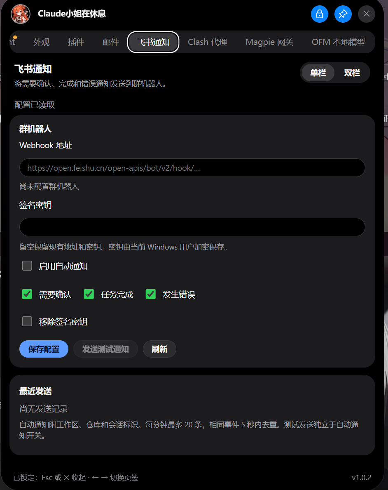
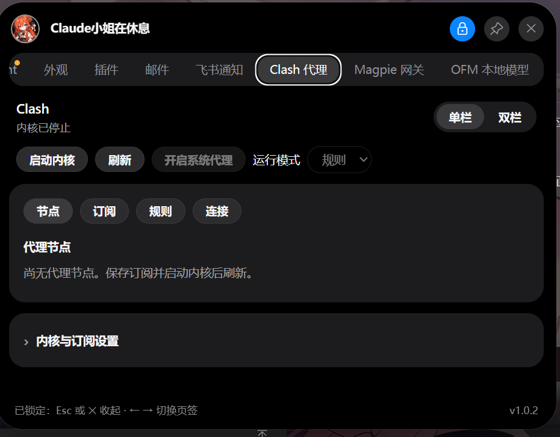
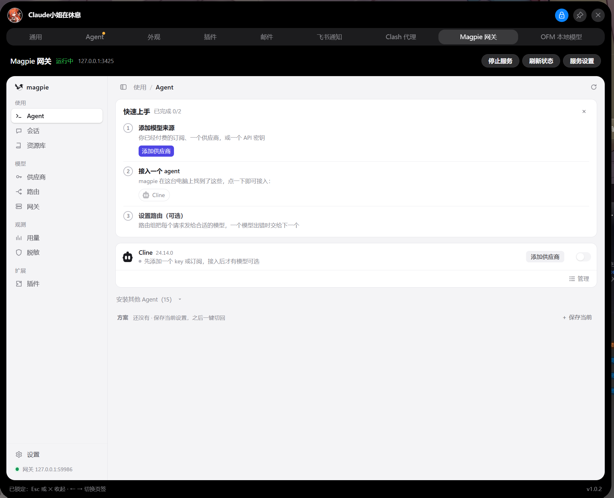
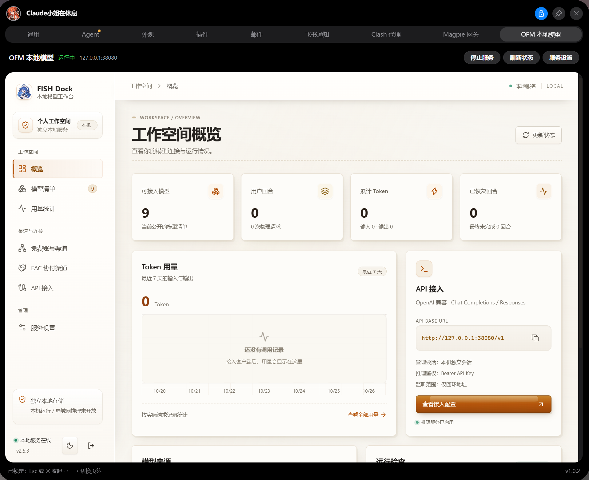

<div align="center">

<p>
  <a href="README.md"><picture><source media="(prefers-color-scheme: dark)" srcset="assets/readme/key-zh-zh-dark.png"></picture></a>
  <a href="https://github.com/Fish-under-sea/FISH-Dock/blob/main/README.en.md"><picture><source media="(prefers-color-scheme: dark)" srcset="assets/readme/key-en-zh-dark.png"></picture></a>
  <a href="#get-started"><picture><source media="(prefers-color-scheme: dark)" srcset="assets/readme/key-start-zh-dark.png"></picture></a>
</p>

<table width="100%">
  <tr>
    <td width="72%" valign="middle" align="left">
      <p><samp>FISH // PLUGINS &amp; CONFIGURATION</samp></p>
      <h1>FISH Dock 插件配置仓</h1>
      <h3>官方插件、配置说明与版本下载</h3>
      <p>飞书通知 · Clash 代理 · Magpie 网关 · OFM 本地模型</p>
      <p><sub>Official plugins, configuration guides and releases.</sub></p>
      <p><kbd>WINDOWS X64</kbd> <kbd>HOST API 1</kbd> <kbd>4 PLUGINS</kbd></p>
    </td>
    <td width="28%" valign="middle" align="center">
      
    </td>
  </tr>
</table>

<table width="100%">
  <tr>
    <td width="25%" align="center" valign="top">
      <p><samp>VERSION</samp></p>
      <h3><a href="https://github.com/Fish-under-sea/FISH-DOCK-Plugins/releases/tag/v1.0.3">1.0.3</a></h3>
      <p><sub>Magpie 1.0.3 · 其余 1.0.2</sub></p>
    </td>
    <td width="25%" align="center" valign="top">
      <p><samp>PLUGINS</samp></p>
      <h3><a href="#plugins">4 PLUGINS</a></h3>
      <p><sub>四个独立插件</sub></p>
    </td>
    <td width="25%" align="center" valign="top">
      <p><samp>PACKAGES</samp></p>
      <h3><a href="#packages">4 PACKS</a></h3>
      <p><sub>四个 npm 单包</sub></p>
    </td>
    <td width="25%" align="center" valign="top">
      <p><samp>HOST API</samp></p>
      <h3><a href="https://github.com/Fish-under-sea/FISH-Dock">API 1</a></h3>
      <p><sub>FISH Dock 1.1.0+</sub></p>
    </td>
  </tr>
</table>

<p>
  <a href="#get-started"><picture><source media="(prefers-color-scheme: dark)" srcset="assets/readme/key-download-zh-dark.png"></picture></a>
  <a href="https://github.com/Fish-under-sea/FISH-DOCK-Plugins/releases/tag/v1.0.3"><picture><source media="(prefers-color-scheme: dark)" srcset="assets/readme/key-release-zh-dark.png"></picture></a>
  <a href="https://github.com/Fish-under-sea/FISH-DOCK-Plugins/issues"><picture><source media="(prefers-color-scheme: dark)" srcset="assets/readme/key-issues-zh-dark.png"></picture></a>
</p>

</div>

<h2 id="intro"><picture><source media="(prefers-color-scheme: dark)" srcset="assets/readme/section-intro-dark.png"></picture></h2>

这里是 FISH Dock 的插件配置仓，集中提供四个官方插件的功能介绍、配置说明、安装包和更新记录。下载标准 `.fish-plugin` 包后，可在 Dock 的「插件」页导入；也可以通过 npm 获取对应插件归档。

每个插件独立保存配置与凭据，按需启动，不共享业务密钥。插件仓只发布插件资源，桌面安装包请前往 [FISH-Dock](https://github.com/Fish-under-sea/FISH-Dock)。

最新补丁：[Magpie 1.0.3](https://github.com/Fish-under-sea/FISH-DOCK-Plugins/releases/tag/v1.0.3)，修复 DSH、Codex 的旧 MCP 占用运行文件时升级启动失败的问题。不同原生版本按摘要并存，实际副本每次校验，账号与渠道资料保留；原生更新仍由 Dock 插件管理。随包原生为官方 0.1.1709，飞书、Clash、OFM 保持 1.0.2。

<h2 id="plugins"><picture><source media="(prefers-color-scheme: dark)" srcset="assets/readme/section-features-dark.png"></picture></h2>

### 飞书通知

群机器人通知、事件筛选和签名配置。Webhook 与签名密钥保存在插件自己的加密凭据空间。

<p align="center"></p>

### Clash 代理

基于 mihomo 的代理管理，提供订阅、节点、规则和系统代理控制。代理内核只绑定回环地址。

<p align="center"></p>

### Magpie 网关

独立模型网关与原生管理页。管理页、模型网关和 Dock 嵌入代理使用独立回环端口，避免相互占用。

<p align="center"></p>

### OFM 本地模型（灰度）

本地模型渠道和 API 工作台。目前属于灰度测试，暂未开放完整的登录、项目绑定和模型调用流程。

<p align="center"></p>

<h2 id="get-started"><picture><source media="(prefers-color-scheme: dark)" srcset="assets/readme/section-install-dark.png"></picture></h2>

1. 安装 [FISH Dock 1.1.0](https://github.com/Fish-under-sea/FISH-Dock/releases/tag/v1.1.0)。
2. 在「插件」页检查更新、选择插件并确认安装；或按下表下载对应版本的 `.fish-plugin`，核对同版 `SHA256SUMS.txt` 后导入。
3. 安装后进入插件页确认运行状态；需要账号或订阅的插件，再进入对应页面完成配置。

| 插件 | GitHub 包 | npm 单包 |
| --- | --- | --- |
| 飞书 | [`feishu.fish-plugin`](https://github.com/Fish-under-sea/FISH-DOCK-Plugins/releases/download/v1.0.2/feishu.fish-plugin) | [`@fish-under-sea/fish-dock-plugin-feishu`](https://www.npmjs.com/package/@fish-under-sea/fish-dock-plugin-feishu/v/1.0.2) |
| Clash | [`clash.fish-plugin`](https://github.com/Fish-under-sea/FISH-DOCK-Plugins/releases/download/v1.0.2/clash.fish-plugin) | [`@fish-under-sea/fish-dock-plugin-clash`](https://www.npmjs.com/package/@fish-under-sea/fish-dock-plugin-clash/v/1.0.2) |
| Magpie 1.0.3 | [`magpie.fish-plugin`](https://github.com/Fish-under-sea/FISH-DOCK-Plugins/releases/download/v1.0.3/magpie.fish-plugin) | [`@fish-under-sea/fish-dock-plugin-magpie`](https://www.npmjs.com/package/@fish-under-sea/fish-dock-plugin-magpie/v/1.0.3) |
| OFM | [`ofm.fish-plugin`](https://github.com/Fish-under-sea/FISH-DOCK-Plugins/releases/download/v1.0.2/ofm.fish-plugin) | [`@fish-under-sea/fish-dock-plugin-ofm`](https://www.npmjs.com/package/@fish-under-sea/fish-dock-plugin-ofm/v/1.0.2) |

<h2 id="packages"><picture><source media="(prefers-color-scheme: dark)" srcset="assets/readme/section-install-dark.png"></picture></h2>

每个 npm 包只包含一个对应的插件归档和下载 CLI，不运行安装后脚本，不修改 Dock 或系统设置。

```powershell
npm install @fish-under-sea/fish-dock-plugin-magpie@1.0.3
npx @fish-under-sea/fish-dock-plugin-magpie --out C:/work/plugins
```

四个包分别是 `@fish-under-sea/fish-dock-plugin-feishu`、`@fish-under-sea/fish-dock-plugin-clash`、`@fish-under-sea/fish-dock-plugin-magpie` 和 `@fish-under-sea/fish-dock-plugin-ofm`。

<h2 id="development"><picture><source media="(prefers-color-scheme: dark)" srcset="assets/readme/section-develop-dark.png"></picture></h2>

需要 Node.js 24 和相邻 Dock 仓的 SDK。开发暂存、正式插件包和 npm 单包使用不同输出目录。

```powershell
node tools/stage-development.mjs --out C:/work/preview-plugins --sdk ../FISH-Dock/sdk --ofm ../FISH-Dock/dsh-our-free-model --magpie C:/work/runtimes/magpie.exe --mihomo C:/work/runtimes/mihomo.exe
node tools/build-release.mjs --out C:/work/release-1.0.0 --sdk ../FISH-Dock/sdk --ofm ../FISH-Dock/dsh-our-free-model --magpie C:/work/runtimes/magpie.exe --mihomo C:/work/runtimes/mihomo.exe
node tools/build-npm-packages.mjs --dist C:/work/release-1.0.0/dist --out C:/work/npm-plugin-packages-1.0.0
node --test --test-isolation=none 'plugins/feishu/*.test.mjs' 'plugins/clash/*.test.mjs' 'plugins/magpie/*.test.mjs' 'plugins/ofm/*.test.mjs' 'shared/*.test.mjs' 'tools/*.test.mjs'
```

<h2 id="source"><picture><source media="(prefers-color-scheme: dark)" srcset="assets/readme/section-intro-dark.png"></picture></h2>

本仓的插件适配层与发布工具采用 MIT。发行包同时包含第三方运行时：Clash 使用 GPL-3.0 许可的 mihomo，Magpie 使用其随包许可证，OFM 基于 [Our Free Model](https://github.com/Ebony-Vinyl/dsh-our-free-model) 的 standalone 构建与渠道能力。因此“适配层 MIT”不等于“包含的全部二进制均为 MIT”，第三方许可以 [THIRD_PARTY_NOTICES.md](THIRD_PARTY_NOTICES.md) 和各插件包内的 `licenses` 目录为准。

<p align="center"><sub>FISH Dock Official Plugins · Four independent packages · Host API 1</sub></p>
