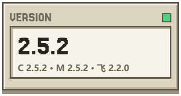
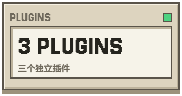
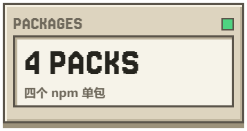

<div align="center">

<p>
  <a href="README.md"><picture><source media="(prefers-color-scheme: dark)" srcset="assets/readme/key-zh-zh-dark.png"></picture></a>
  <a href="README.en.md"><picture><source media="(prefers-color-scheme: dark)" srcset="assets/readme/key-en-zh-dark.png"></picture></a>
  <a href="docs/developers/README.md"><picture><source media="(prefers-color-scheme: dark)" srcset="assets/readme/key-start-zh-dark.png"></picture></a>
</p>

<picture>
  <source media="(prefers-color-scheme: dark)" srcset="assets/readme/config-hero-zh-dark.png">
  
</picture>

<p>
  <a href="https://github.com/Fish-under-sea/FISH-DOCK-Plugins/releases/tag/v2.5.0"><picture><source media="(prefers-color-scheme: dark)" srcset="assets/readme/config-stat-version-zh-dark.png"></picture></a>
  <a href="#plugins"><picture><source media="(prefers-color-scheme: dark)" srcset="assets/readme/config-stat-desktop-zh-dark.png"></picture></a>
  <a href="#packages"><picture><source media="(prefers-color-scheme: dark)" srcset="assets/readme/config-stat-mail-zh-dark.png"></picture></a>
  <a href="https://github.com/Fish-under-sea/FISH-Dock"><picture><source media="(prefers-color-scheme: dark)" srcset="assets/readme/config-stat-channels-zh-dark.png"></picture></a>
</p>

<p>   </p>
<p><strong>FISH Plugins &amp; Configuration · 插件配置仓</strong><br>官方插件、配置说明与发行入口；按需安装，独立运行。</p>

<p>
  <a href="#get-started"><picture><source media="(prefers-color-scheme: dark)" srcset="assets/readme/key-download-zh-dark.png"></picture></a>
  <a href="https://github.com/Fish-under-sea/FISH-DOCK-Plugins/releases/tag/v2.5.0"><picture><source media="(prefers-color-scheme: dark)" srcset="assets/readme/key-release-zh-dark.png"></picture></a>
  <a href="https://github.com/Fish-under-sea/FISH-DOCK-Plugins/issues"><picture><source media="(prefers-color-scheme: dark)" srcset="assets/readme/key-issues-zh-dark.png"></picture></a>
</p>

</div>

<h2 id="intro"><picture><source media="(prefers-color-scheme: dark)" srcset="assets/readme/section-intro-dark.png"></picture></h2>

这里是 FISH Dock 的插件配置仓，集中提供三个官方插件的功能介绍、配置说明、安装包和更新记录。下载标准 `.fish-plugin` 包后，可在 Dock 的「插件」页导入；也可以通过 npm 获取对应插件归档。

每个插件独立保存配置与凭据，按需启动，不共享业务密钥。插件仓只发布插件资源，桌面安装包请前往 [FISH-Dock](https://github.com/Fish-under-sea/FISH-Dock) 。

当前发行（以 `catalog/stable.json` 为唯一权威）：Magpie **2.5.0**（要求 FISH Dock ≥ 2.3.4）、Clash **2.5.0**（内置 mihomo 1.19.34，要求 FISH Dock ≥ 2.0.0）、飞书 **2.2.0**；详见 [2.5.0 发行说明](docs/releases/2.5.0.md) 。

**最近版本**（仅展示最近 3 版；完整历史见 [历史发行说明](docs/releases) 与 [GitHub Releases](https://github.com/Fish-under-sea/FISH-DOCK-Plugins/releases) ）

- **2.5.0** · Magpie（`v0.1.4650+fish.50`）追平上游并重扫 165 条玻璃表面规则，接入 Dock 液态玻璃与字体「跟随」联动，玻璃模式下顶部服务条自动透明并收敛强调色对玻璃底色的染色；Clash 内置 mihomo 升级至 `v1.19.34`，新增显式环境变量代理开关（`HTTP_PROXY` / `HTTPS_PROXY` / `NO_PROXY` 及看门狗租约还原），同步接入 Dock「跟随」并补齐深色字体单独设置。→ [说明](docs/releases/2.5.0.md)
- **2.4.9** · Magpie（`v0.1.4530+fish.49`）追平上游并重扫 163 条液态玻璃表面规则；Clash 修复严格沙箱 CSP 下壁纸上传失败问题（改用 `createImageBitmap` 与 `FileReader` 兜底），拆分格式、解码与超限报错文案。→ [说明](docs/releases/2.4.9.md)
- **2.4.8** · Magpie（`v0.1.4344+fish.48`）清理供应商遮罩与节点黑圈、统一全站卡片与模型胶囊液态玻璃并同步实时审阅计数；Clash 重构双模式 DNS/Sniffer 与分流规则，独立 GitHub/npm 代理组、过滤订阅伪节点并拦截海外 QUIC。→ [说明](docs/releases/2.4.8.md)
- **2.4.7 及更早** · 见 [历史发行说明](docs/releases) 与 [GitHub Releases](https://github.com/Fish-under-sea/FISH-DOCK-Plugins/releases) （`docs/releases/` 历史原文全部完整保留）。

> ⚠️ **2.0.0 是 breaking 版本**：插件清单新增 `behaviors` 字段，FISH Dock 1.2.3 及更早的宿主用 `deny_unknown_fields` 解析，会以「plugin.json 格式无效或含未知字段」直接拒装。**旧宿主请先把 Dock 升到 2.0.0**，再安装这些插件。

> ⚠️ npm 上 `@fish-under-sea/fish-dock-plugin-clash@1.1.0` 为误发版本（基于旧基线，缺少 1.0.4 的多订阅修复），请勿使用；当前 Magpie 与 Clash 单包均为 `2.5.0`、飞书是 `2.2.0`，OFM 停在 `2.0.1`（已退役）。

<h2 id="plugins"><picture><source media="(prefers-color-scheme: dark)" srcset="assets/readme/section-features-dark.png"></picture></h2>

### 飞书通知

面向飞书群机器人的消息通知插件，支持事件筛选、消息模版和签名测试。Webhook 与签名密钥保存在插件独立加密凭据空间中，无本机后台服务，插件卡上显示「无需自启动」。作者：WTStarMark、FISH。

<p align="center"></p>

### Clash 代理

基于 `mihomo`（`v1.19.34`）内核的桌面代理控制插件，随包内置 `GeoSite.dat` 与 `GeoIP.dat` 规则数据，支持多订阅校验切换、代理组与节点延迟测速、Windows 系统代理与用户级环境变量代理（`HTTP_PROXY` / `HTTPS_PROXY` / `NO_PROXY`）接管与自愈看门狗、Windows TUN 虚拟网卡服务管理，以及独立「外观」调节与 360° Fresnel 液态玻璃主题（支持跟随 Dock 主题与深色字体单独设置）。代理内核仅绑定本地回环地址，与宿主页状态同步互锁。作者：Elysia395、FISH。

<p align="center"></p>

### Magpie 网关

独立多模型网关与原生桌面管理页，统一管理订阅源、API Key、智能路由组与用量统计，并内置 Obsidian 知识库记忆 Agent，可直接串联多款本地 Coding Agent。管理页、模型网关与 Dock 嵌入代理各自采用独立回环端口，并与宿主插件卡共用「自启动」开关；界面支持四区域 360° Fresnel 液态玻璃、Dock 主题/玻璃「跟随」、自定义壁纸与多层级字体配色。扩展页面插件（如「签到 & 探针」与「破甲」）按 npm 包登记并交由 Magpie 自主拉取更新。作者：FISH、Jassdingk。

<p align="center"></p>

### OFM 本地模型（不再随 Dock 显示）

本地模型渠道和 API 工作台。**自 2026 年 10 月 25 日起暂停维护，也不再在 Dock 的插件页里出现**——需要的可从 [GitHub Release](https://github.com/Fish-under-sea/FISH-DOCK-Plugins/releases/download/v2.0.1/ofm.fish-plugin) 或 npm 手动安装（版本停在 `2.0.1`）。已安装版本可继续使用，配置与数据保留；新用户建议使用 Magpie 网关。作者：FISH。

<h2 id="get-started"><picture><source media="(prefers-color-scheme: dark)" srcset="assets/readme/section-install-dark.png"></picture></h2>

安装前先核对宿主版本：Magpie 是 2.5.0（要求 FISH Dock ≥ 2.3.4）、Clash 是 2.5.0、飞书是 2.2.0，**FISH Dock 需要 2.0.0 及以上**；1.2.3 及更早的宿主会因清单里的 `behaviors` 字段拒装。

**方式一：Dock 内插件市场（推荐）**

1. 安装 [FISH Dock 2.0.0](https://github.com/Fish-under-sea/FISH-Dock/releases/tag/v2.0.0) 。
2. 打开「插件」页 →「检查更新」：官方目录（本仓 `catalog/stable.json`）会列出这三个插件，勾选后确认安装。
3. 安装后确认运行状态；需要账号或订阅的插件，再进入对应页面完成配置。

**方式二：npm 单包**

1. `npm install @fish-under-sea/fish-dock-plugin-<插件>@<版本>`（三个包名与各包当前版本见下方「npm 单包」一节）。
2. `npx @fish-under-sea/fish-dock-plugin-<插件> --out C:/work/plugins`：把已校验的 `.fish-plugin` 复制到指定目录；目标已存在同名文件时命令会停下，不覆盖。
3. 在 Dock 的「插件」页导入该 `.fish-plugin`，其余同方式一。

下表给出三个插件对应的 GitHub 包与 npm 单包；GitHub 链接指向各自当前 Release tag。OFM 不在表里——它已退役，只在上面那一节的手动下载入口里。

| 插件 | GitHub 包 | npm 单包 |
| --- | --- | --- |
| 飞书 2.2.0 | [`feishu.fish-plugin`](https://github.com/Fish-under-sea/FISH-DOCK-Plugins/releases/download/v2.2.0/feishu.fish-plugin) | [`@fish-under-sea/fish-dock-plugin-feishu`](https://www.npmjs.com/package/@fish-under-sea/fish-dock-plugin-feishu/v/2.2.0) |
| Clash 2.5.0 | [`clash.fish-plugin`](https://github.com/Fish-under-sea/FISH-DOCK-Plugins/releases/download/v2.5.0/clash.fish-plugin) | [`@fish-under-sea/fish-dock-plugin-clash`](https://www.npmjs.com/package/@fish-under-sea/fish-dock-plugin-clash/v/2.5.0) |
| Magpie 2.5.0 | [`magpie.fish-plugin`](https://github.com/Fish-under-sea/FISH-DOCK-Plugins/releases/download/v2.5.0/magpie.fish-plugin) | [`@fish-under-sea/fish-dock-plugin-magpie`](https://www.npmjs.com/package/@fish-under-sea/fish-dock-plugin-magpie/v/2.5.0) |

<h2 id="packages"><picture><source media="(prefers-color-scheme: dark)" srcset="assets/readme/section-packages-dark.png"></picture></h2>

每个 npm 包只包含一个对应的插件归档和下载 CLI（bin 名 `fish-dock-plugin-<插件>`），不运行安装后脚本，不修改 Dock 或系统设置。当前 npm 上 **Magpie 与 Clash 均为 2.5.0、飞书是 2.2.0**（OFM 单包停在 2.0.1，已退役只供手动下载），要求 **Node.js ≥ 24** 与 **FISH Dock ≥ 2.0.0**。

| npm 单包（完整包名） | 版本 | bin | `npm pack` 体积 |
| --- | --- | --- | --- |
| `@fish-under-sea/fish-dock-plugin-feishu` | 2.2.0 | `fish-dock-plugin-feishu` | 38.6 kB（6 个文件） |
| `@fish-under-sea/fish-dock-plugin-clash` | 2.5.0 | `fish-dock-plugin-clash` | 27.4 MB（7 个文件，含 mihomo 许可） |
| `@fish-under-sea/fish-dock-plugin-magpie` | 2.5.0 | `fish-dock-plugin-magpie` | 55.3 MB（7 个文件，含 Magpie 许可） |
| `@fish-under-sea/fish-dock-plugin-ofm` | 2.0.1（暂停维护，仅手动） | `fish-dock-plugin-ofm` | 1.9 MB（6 个文件） |

```powershell
npm install @fish-under-sea/fish-dock-plugin-clash@2.5.0
npx @fish-under-sea/fish-dock-plugin-clash --out C:/work/plugins
```

`--out` 只接收一个目录：命令把已校验的 `clash.fish-plugin`（按 SHA-256 与包内记录比对）复制进去；目标已存在同名文件时直接停下，不覆盖。复制完在 Dock 的「插件」页导入即可。三个包名分别是 `feishu`、`clash`、`magpie`，把上例里的 `clash` 换成对应名字即可。

<h2 id="development"><picture><source media="(prefers-color-scheme: dark)" srcset="assets/readme/section-develop-dark.png"></picture></h2>

需要 Node.js 24 和相邻 Dock 仓的 SDK。开发暂存、正式插件包和 npm 单包使用不同输出目录。

```powershell
node tools/stage-development.mjs --out C:/work/preview-plugins --sdk ../FISH-Dock/sdk --magpie C:/work/runtimes/magpie.exe --mihomo C:/work/runtimes/mihomo.exe
node tools/build-release.mjs --out C:/work/release-2.4.8 --sdk ../FISH-Dock/sdk --magpie C:/work/runtimes/magpie.exe --mihomo C:/work/runtimes/mihomo.exe --version 2.4.8
node tools/build-npm-packages.mjs --dist C:/work/release-2.4.8/dist --out C:/work/npm-plugin-packages-2.4.8
node --test --test-isolation=none 'plugins/feishu/*.test.mjs' 'plugins/clash/*.test.mjs' 'plugins/magpie/*.test.mjs' 'shared/*.test.mjs' 'tools/*.test.mjs' 'plugins/magpie/obsidian-plugin/*.test.cjs'
```

### 文档

写插件、改插件、发版之前先看这几份，它们跟着代码一起改：

| 文档 | 讲什么 |
| --- | --- |
| [插件开发者指南](docs/developers/README.md) | 仓库边界、`plugin.json` 的字段、后台 SDK 与页面、行为钩子、读与调用的声明 |
| [液态玻璃与主题联动 Hook](docs/developers/liquid-glass-hooks.md) | 宿主 `FishDock.theme` 与 Magpie `magpie.onGlass` 的 CSS 变量、状态属性、JS 钩子与降级写法 |
| [外部原生窗口 Hook](docs/developers/native-window-hook.md) | 插件外部原生窗口、`file-drop`、`dock` 几何与 `dialogs` 宿主能力接口 |
| [自启动按钮钩子](docs/developers/autostart-hook.md) | `behaviors.autostart` 与 `FISH_PLUGIN_AUTOSTART=1` 的唯一行为契约 |
| [插件维护者指南](docs/maintainers/README.md) | 身份表（作者与状态说明只在一处维护）、固定来源与资源、发行流程、开发暂存 |
| [自编译 Magpie](plugins/magpie/tools/README.md) | 补丁清单与每一处为什么补、构建命令、版本标识、跟着上游升级时会踩的坑 |
| [签到&探针说明](https://github.com/Fish-under-sea/magpie-checkin-relay-probe) | 宿主提供哪些读与调用、「预装插件美化」开关怎么工作、素材为什么编进 exe |
| [厂商素材来源](https://github.com/Fish-under-sea/magpie-checkin-relay-probe/tree/main/page/checkin/logos) | 每张厂商图的来源、裁切范围与授权状况 |
| [发行说明](docs/releases/) | 逐版本的改动与验证；最新是 [2.5.0](docs/releases/2.5.0.md) |
| [第三方许可](THIRD_PARTY_NOTICES.md) | 随包运行时的许可与来源（mihomo 的 GPL-3.0、Magpie 的随包许可等） |
| [README 头图维护](assets/readme/MAINTAINING.md) | 头图怎么渲染、字号与卡片尺寸的约束、哪些东西不能换 |

新增插件或改了行为，**先改对应的那份文档，再发版**——上面的链接都不允许指向一份过期的说明。

<h2 id="thanks"><picture><source media="(prefers-color-scheme: dark)" srcset="assets/readme/section-thanks-dark.png"></picture></h2>

这三个上游各自撑起了本仓的一部分。**没有它们，这里的插件只是几个空壳**——按分量排，依次是：

### [Magpie](https://github.com/yetone/magpie) · 模型网关与插件宿主

整个 Magpie 插件的地基。供应商注册、页面与面板桥、签到与额度读取、网关路由，全部是上游的代码；本仓写着「Magpie 插件」的那层，实际上只是它的适配层、页面与发布工具。

本仓发布的 `magpie.fish-plugin` 走的是**其源码自编译**：基线上游 tag（当前 `v0.1.4650`），加上 `patches/` 里我们自己的累计补丁（当前累计至 `fish.50`：追平上游 `v0.1.4650` 并重扫 165 条液态玻璃表面规则，新增 Dock 液态玻璃与字体「跟随」联动、玻璃模式下顶部服务条自动透明并收敛强调色对玻璃底色的染色，延续全页面液态玻璃与自定义字体调色命中、Obsidian 记忆 Agent 与紫色晶石图标、`magpie.call` 通道与本地素材接管等增强）。补丁的每一处、为什么补、怎么复现，都写在 [plugins/magpie/tools/README.md](plugins/magpie/tools/README.md) 里。上游的版本标识与第三方声明随包保留（`licenses/Magpie.txt`）。

### [mihomo](https://github.com/MetaCubeX/mihomo) · Clash 内核

Clash 插件的内核是 mihomo，GPL-3.0 许可。节点、订阅、规则、TUN，真正干活的是它；本仓只写适配层与页面，内核一行没改。发行包里带的是官方 release 的 Windows amd64 构建，`licenses/mihomo.txt` 是它随包的许可证全文，源码与构建方式见上游仓库。

### [Our Free Model](https://github.com/Ebony-Vinyl/dsh-our-free-model) · OFM 的底座

OFM 基于 Our Free Model 的 standalone 构建与渠道能力。该插件自 2026 年 10 月 25 日起暂停维护，已经装好的版本继续可用，配置与数据保留。

### 许可证边界

本仓的插件适配层与发布工具采用 MIT。发行包同时包含上面这些第三方运行时，所以「适配层 MIT」不等于「包含的全部二进制均为 MIT」：以 [THIRD_PARTY_NOTICES.md](THIRD_PARTY_NOTICES.md) 和各插件包内的 `licenses` 目录为准。

<p align="center"><sub>FISH Dock Official Plugins · Four independent packages · Host API 1</sub></p>

