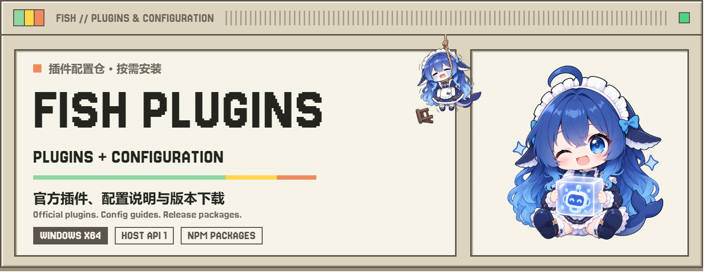
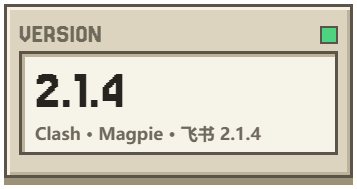
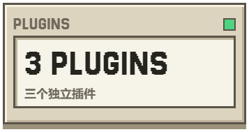
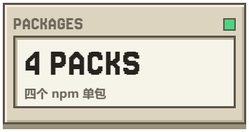
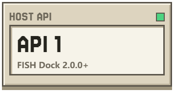
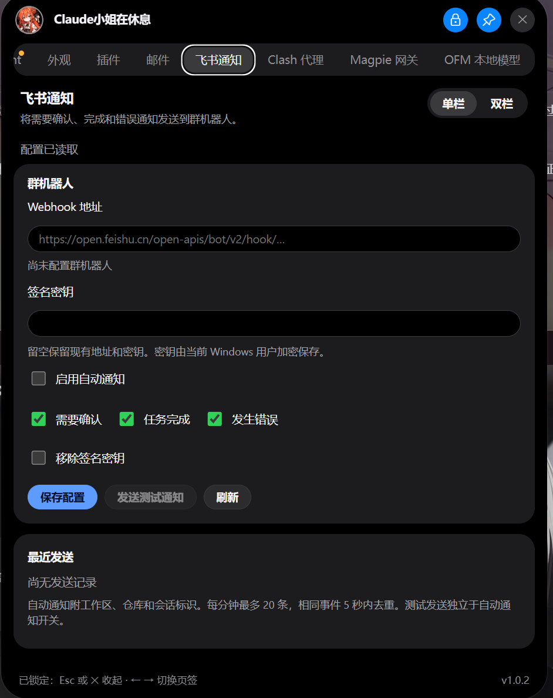
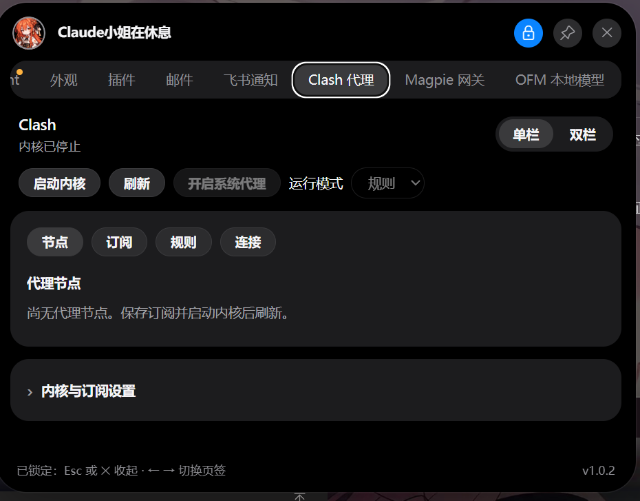
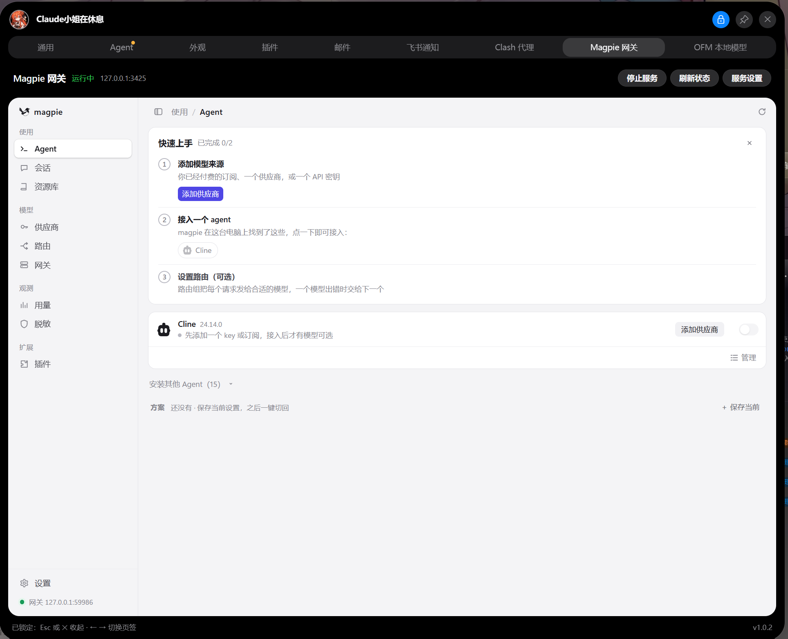

<div align="center">

<p>
  <a href="README.md"><picture><source media="(prefers-color-scheme: dark)" srcset="assets/readme/key-zh-zh-dark.png"></picture></a>
  <a href="https://github.com/Fish-under-sea/FISH-Dock/blob/main/README.en.md"><picture><source media="(prefers-color-scheme: dark)" srcset="assets/readme/key-en-zh-dark.png"></picture></a>
  <a href="docs/developers/README.md"><picture><source media="(prefers-color-scheme: dark)" srcset="assets/readme/key-start-zh-dark.png"></picture></a>
</p>

<picture>
  <source media="(prefers-color-scheme: dark)" srcset="assets/readme/config-hero-zh-dark.png">
  
</picture>

<p>
  <a href="https://github.com/Fish-under-sea/FISH-DOCK-Plugins/releases/tag/v2.1.8"><picture><source media="(prefers-color-scheme: dark)" srcset="assets/readme/config-stat-version-zh-dark.png"></picture></a>
  <a href="#plugins"><picture><source media="(prefers-color-scheme: dark)" srcset="assets/readme/config-stat-desktop-zh-dark.png"></picture></a>
  <a href="#packages"><picture><source media="(prefers-color-scheme: dark)" srcset="assets/readme/config-stat-mail-zh-dark.png"></picture></a>
  <a href="https://github.com/Fish-under-sea/FISH-Dock"><picture><source media="(prefers-color-scheme: dark)" srcset="assets/readme/config-stat-channels-zh-dark.png"></picture></a>
</p>

<p>   </p>
<p><strong>FISH Plugins &amp; Configuration · 插件配置仓</strong><br>官方插件、配置说明与发行入口；按需安装，独立运行。</p>

<p>
  <a href="#get-started"><picture><source media="(prefers-color-scheme: dark)" srcset="assets/readme/key-download-zh-dark.png"></picture></a>
  <a href="https://github.com/Fish-under-sea/FISH-DOCK-Plugins/releases/tag/v2.1.8"><picture><source media="(prefers-color-scheme: dark)" srcset="assets/readme/key-release-zh-dark.png"></picture></a>
  <a href="https://github.com/Fish-under-sea/FISH-DOCK-Plugins/issues"><picture><source media="(prefers-color-scheme: dark)" srcset="assets/readme/key-issues-zh-dark.png"></picture></a>
</p>

</div>

<h2 id="intro"><picture><source media="(prefers-color-scheme: dark)" srcset="assets/readme/section-intro-dark.png"></picture></h2>

这里是 FISH Dock 的插件配置仓，集中提供三个官方插件的功能介绍、配置说明、安装包和更新记录。下载标准 `.fish-plugin` 包后，可在 Dock 的「插件」页导入；也可以通过 npm 获取对应插件归档。

每个插件独立保存配置与凭据，按需启动，不共享业务密钥。插件仓只发布插件资源，桌面安装包请前往 [FISH-Dock](https://github.com/Fish-under-sea/FISH-Dock)。

本版**两个插件**：**Magpie 2.1.7 → 2.1.8**（追一次上游到 `v0.1.2799`，补齐 NearToken 分组墙契约）、**Clash 2.1.5 → 2.1.8**（测速不再被宿主的 15 秒掐断、换订阅不用再自己重启内核、关掉 geo 自动更新）。飞书保持 2.1.5。要求 **FISH Dock ≥ 2.0.0**。完整改动见 [2.1.8 发行说明](docs/releases/2.1.8.md)。

**2.1.8 改了什么**

- **Clash：测速不再变成「未识别错误」**：旧实现「并发 6 + 每节点 5 秒」，37 个节点要 30 秒以上，超过宿主给插件的 15 秒 RPC 上限，宿主回一句没有错误码的「插件响应超时」，页面只能折叠成「未识别错误」。现在测速自己带预算（并发 8 / 单节点 2.5 秒 / 整段 9 秒封顶），来不及测的节点如实标成未测；宿主那两句没码的话也有了专门文案。
- **Clash：换订阅启用失败时插件自己重启内核**：热重载（`PUT /configs?force=true`）失败不再把「请重启内核」丢给用户——插件立刻按新启用集重启一次，两次都失败才回滚并报错。
- **Clash：关掉 `geo-auto-update`**：开着它时内核会在启动或重载那一刻去 GitHub 下 geosite/geoip，网络不通就直接 `Parse config error` 退出（本地实测 20 秒后 fatal）。geo 文件本来就随包发布，启动时由 `ensureGeoData` 落地。
- **Magpie：追上游 `v0.1.2732` → `v0.1.2799`**：补丁 `fish.12`，`git apply -3` 只剩 `core_budget_test.go` 一处冲突，按上游规矩取实测值（1,534,429）。
- **Magpie：NearToken 分组墙契约**：`neartoken:state` 多回 `groupList`（站点原文组名 + 倍率 + 该组能聊的模型数 + ref，没读过目录时是空数组）与 `tokenName`；页面据此画可点分组墙，点一下写 `disabledGroups`，插件侧自己过滤模型。
- **包与版本**：Clash **2.1.8**、Magpie **2.1.8**、飞书 2.1.5；`magpie.exe` 版本资源 `0.1.2799.12`（ProductName `magpie fish`）；`page-checkin` 0.2.6、`page-relay-probe` 0.1.2。

> ℹ️ **2.1.3 的已知限制已在 2.1.4 修复**：讯飞今日积分显示 400 的问题（读取侧补偿）随 #18 的 B1 移除，读不到真实积分时显示「未告知」。

<details>
<summary><b>2.1.7 / 2.1.6 / 2.1.5 / 2.1.2 / 2.1.0 改了什么</b></summary>

<br>

**2.1.7 改了什么（仅 Magpie）**

- **NearToken 不再被宿主那条供应商盖住（#22）**：插件 0.1.7 起自己就是 provider 插件，宿主让出那条 key+URL 供应商——不再 `provider.Save`、不再写模型表，页面八条 `neartoken:*` 改从插件凭据读令牌；老用户升级把旧钥匙搬进插件 auth 再删那条；断开时撤令牌 + 删插件凭据 + 删宿主侧那条。
- **中转站探针的图标**：换成图钉（📌）描边图标，`magpie.page.icon` 与 `magpie.icon` 同指 `page/icon.svg`，深浅两套颜色写在 SVG 里；删掉那张 109 KB 灰色位图。

**2.1.6 改了什么（仅 Magpie）**

- 接入 NearToken 页面插件的八条宿主调用（`neartoken:*`）。
- 插件页超链接改由宿主用系统浏览器打开（沙箱帧里 `<a href>` 打不开）。
- 内置「中转站探针」界面重做并补操作教程（`page-relay-probe` 0.1.1）；exe 补丁推进到 `+fish.10`。

**2.1.5 改了什么**

- **Clash：七项 UX 修复 + 订阅运行中热切换**：胶囊按钮不再被长文案压成竖排圆块（禁用原因拆成按钮下方小字）；详情卡「复制」按钮移除、左右两卡行高基线对齐；**点订阅卡 = 高亮 + 切换启用**（同时只允许一条启用，卡内开关与卡片高亮双向联动）；内核运行中切换订阅**热重载配置，不停内核**（失败自动回滚启用集与配置文件）；下拉弹层内滚轮不再误关闭；两个下拉箭头换成内联 SVG 垂直居中；读数行数值不再被裁。注意一条行为变化：**没有缓存的订阅现在直接拒绝启用**（此前是「启用成功、下次启动内核才失败」），避免内核带着空 provider 起来。
- **Clash 两个下拉触发器首列对齐（2.1.5 补发）**：`justify-content:flex-start` + 图标盒恒在 + 右侧那组贴右（有延迟由延迟吃 `auto`，没有则由箭头吃），两个触发器的文字相对左边缘偏移实测 37px = 37px；顺带修掉「无 emoji 时首列少 24px」。
- **飞书页面按 2.1.4 设计语言重构**：单栏与双栏两套布局分别设计（不是一套挤成两列，720px 以下自动降单栏）；token 化自持深浅主题；布局切换器、卡片、按钮语义、状态 banner 与无障碍全部对齐 Clash 同款刻度。
- **Magpie 2.1.4 起的改动**：exe 基线 `v0.1.2732`，新增内置 Meoo 秒悟（建站 Agent）、OpenCode Zen Free 移出预装（已装用户不受影响，美化素材保留）、#18 五项落地——讯飞不再显示假 400（读不到真实积分就「未告知」）、签到数据带「截至时间/来源」、不支持采集的显示标记、首启「正在准备 N 个供应商插件」可用、首启图标不再抖动；`preinstall-state.json` 首启落盘接上线。

**2.1.2 改了什么**

- **插件出错时终于能被看见**：Clash 的内核运行态落盘并支持重启后 attach，不再出现「内核已停止但代理仍然有效」；停止时内核与系统代理分别报错，恢复代理失败不再阻断杀内核。
- **不再误杀被复用的 pid**：残留内核回收从「pid 存活就结束」改成 pid + 实际启动时刻（±5 秒）+ 控制器可达三重判定；控制器连得上就不发信号，启动时刻对不上也不杀——宁可留一个僵尸内核让你手动结束，也不 SIGKILL 掉别人的程序。
- **换节点立刻换 IP**：切换节点后同时清服务端 `ipCache` 与页面缓存，面板出口 IP、ASN 当场刷新。
- **Magpie 端口先占后拉**：`embedProxy` 的绑定挪到复制运行时、拉起子进程之前，端口冲突在绑定阶段就报 `PORT_IN_USE`，不再「先拉起来再回滚」。
- **失败有日志、启动会自愈**：Magpie 启动失败写 `gateway-error.log`（每行 JSON，含阶段与端口），并按 3 次退避重试；成功后清理历史运行时副本，只留当前 + 1 份回选缓存。
- **错误码体系扩到 67 条**：两个插件裸抛的中文校验错误全部挂码，页面按 code 查表显示专属文案与「下一步做什么」；「请检查配置和运行状态后重试」这句兜底话术彻底移除。

**2.1.0 改了什么**（三个插件同为 2.1.0，Magpie 另有 2.1.1 修图标顺序）

- 「扩展 → 插件 → 已安装」这一页也认品牌图标了——它读的是包自己的 `magpie.icon`，与上一版接管的四处不是同一条路；
- 包内的相对路径图（`page/icon.png`）也读得出来，「自动签到 / 中转站探针」不再是那个灰书页；
- 图标在列表里从 18px 放到 23px；
- 2.0.5 塞错位置的两张立绘挪回 `magpie.icon`：侧边栏那两个页面入口恢复各自的图标，立绘只出现在插件列表里；
- exe 升到 `magpie v0.1.2336+fish.8`。

</details>

<details>
<summary><b>更早的版本（2.0.1 → 2.0.9）</b></summary>

<br>

| 版本 | 一句话 |
| --- | --- |
| **2.0.1** | #11 的收口：自启动只留宿主插件卡一个入口，插件页里那颗重复的胶囊连同 `dock.autostart` 一起删掉；Magpie 上游追到 `v0.1.2336+fish.3`（2.0.0 误附了未打补丁的官方 exe，签到页与探针的写动作发不出去）；内置 15 项预装基线（13 个社区供应商插件首启登记、2 个页面插件随包分发）；Clash 修节点下拉点开就消失、TUN 与普通模式互占端口 |
| **2.0.2** | Clash：节点列表与代理组横条不再被轮询重绘弹回起点，TUN 可以在内核运行时直接切换 |
| **2.0.3** | Magpie：讯飞改成一天一个号、一次按 400 记；签到页补科大讯飞与 ZCode 的标志；exe `+fish.4` |
| **2.0.4** | 讯飞「今日」在读取侧也按 400 补正（历史记录不再是 0）；图标改成带底色的圆角方块并给出深色版 |
| **2.0.5** | 讯飞改回「全部账号都签、每号 400」（2.0.3/2.0.4 误做成只签一个号）；签到页补 Cline / OpenCode / MiMo 的深色版与 Trae 抠图；两个内置插件的图标换成品牌图 |
| **2.0.6** | Clash：出口 IP 查询真正接通、概览只显示当前订阅、订阅页点卡片启停、规则与连接两页补上真实列表 |
| **2.0.7** | Clash：页签/启停/刷新并成一行，内核设置独立成页，节点页加「测速」，规则页与连接页移除，修掉「一滑就被拉回」 |
| **2.0.8** | Magpie：预装插件的图标接管整个窗口（插件页、供应商页、侧边栏、路由与用量卡片），素材编进 exe，exe `+fish.7` |
| **2.0.9** | Clash：订阅改成单选、节点页签删除、测速搬到主界面「当前节点」卡、超时显示红字、字号收敛成三档 |

每一条的完整改动与验证都在 [docs/releases/](docs/releases/) 下。
</details>

> ⚠️ **2.0.0 是 breaking 版本**：插件清单新增 `behaviors` 字段，FISH Dock 1.2.3 及更早的宿主用 `deny_unknown_fields` 解析，会以「plugin.json 格式无效或含未知字段」直接拒装。**旧宿主请先把 Dock 升到 2.0.0**，再安装这四个插件。

> ⚠️ npm 上 `@fish-under-sea/fish-dock-plugin-clash@1.1.0` 为误发版本（基于旧基线，缺少 1.0.4 的多订阅修复），请勿使用；三个插件单包已到 `2.1.4`，OFM 停在 `2.0.1`。

<h2 id="plugins"><picture><source media="(prefers-color-scheme: dark)" srcset="assets/readme/section-features-dark.png"></picture></h2>

### 飞书通知

群机器人通知、事件筛选和签名配置。Webhook 与签名密钥保存在插件自己的加密凭据空间。作者：WTStarMark、FISH。没有本机服务，插件卡上显示「无需自启动」。

<p align="center"></p>

### Clash 代理

基于 mihomo 的代理管理，提供订阅、节点、规则和系统代理控制。代理内核只绑定回环地址。作者：Elysia395、FISH。

<p align="center"></p>

### Magpie 网关

独立模型网关与原生管理页。管理页、模型网关和 Dock 嵌入代理使用独立回环端口，避免相互占用。网关页与服务页共用一颗「自启动」胶囊，决定服务是否随 Dock 启动；插件卡上是同一份状态。签到页随包内置，按厂商分组、支持一键签到与积分刷新。作者：FISH、Jassdingk。

<p align="center"></p>

### OFM 本地模型（不再随 Dock 显示）

本地模型渠道和 API 工作台。**自 2026 年 10 月 25 日起暂停维护，也不再在 Dock 的插件页里出现**——需要的从 [GitHub Release](https://github.com/Fish-under-sea/FISH-DOCK-Plugins/releases/download/v2.0.1/ofm.fish-plugin) 或 npm 手动装（版本停在 `2.0.1`）。已经装好的版本可以继续用，配置与数据保留；要模型网关请迁移到 Magpie。作者：FISH。

<h2 id="get-started"><picture><source media="(prefers-color-scheme: dark)" srcset="assets/readme/section-install-dark.png"></picture></h2>

安装前先核对宿主版本：Clash 与飞书是 2.1.5、Magpie 是 2.1.6，**FISH Dock 需要 2.0.0 及以上**；1.2.3 及更早的宿主会因清单里的 `behaviors` 字段拒装。

**方式一：Dock 内插件市场（推荐）**

1. 安装 [FISH Dock 2.0.0](https://github.com/Fish-under-sea/FISH-Dock/releases/tag/v2.0.0)。
2. 打开「插件」页 →「检查更新」：官方目录（本仓 `catalog/stable.json`）会列出这四个插件，勾选后确认安装。
3. 安装后确认运行状态；需要账号或订阅的插件，再进入对应页面完成配置。

**方式二：npm 单包**

1. `npm install @fish-under-sea/fish-dock-plugin-<插件>@2.1.5`（三个包名见下方「npm 单包」一节）。
2. `npx @fish-under-sea/fish-dock-plugin-<插件> --out C:/work/plugins`：把已校验的 `.fish-plugin` 复制到指定目录；目标已存在同名文件时命令会停下，不覆盖。
3. 在 Dock 的「插件」页导入该 `.fish-plugin`，其余同方式一。

下表给出三个插件对应的 GitHub 包与 npm 单包；GitHub 链接指向本次使用的 Release tag，发布前可能尚未生效。OFM 不在表里——它不随 Dock 显示，只在上面那一节的手动下载入口里。

| 插件 | GitHub 包 | npm 单包 |
| --- | --- | --- |
| 飞书 2.1.5 | [`feishu.fish-plugin`](https://github.com/Fish-under-sea/FISH-DOCK-Plugins/releases/download/v2.1.5/feishu.fish-plugin) | [`@fish-under-sea/fish-dock-plugin-feishu`](https://www.npmjs.com/package/@fish-under-sea/fish-dock-plugin-feishu) |
| Clash 2.1.8 | [`clash.fish-plugin`](https://github.com/Fish-under-sea/FISH-DOCK-Plugins/releases/download/v2.1.8/clash.fish-plugin) | [`@fish-under-sea/fish-dock-plugin-clash`](https://www.npmjs.com/package/@fish-under-sea/fish-dock-plugin-clash/v/2.1.4) |
| Magpie 2.1.8 | [`magpie.fish-plugin`](https://github.com/Fish-under-sea/FISH-DOCK-Plugins/releases/download/v2.1.8/magpie.fish-plugin) | [`@fish-under-sea/fish-dock-plugin-magpie`](https://www.npmjs.com/package/@fish-under-sea/fish-dock-plugin-magpie/v/2.1.4) |

<h2 id="packages"><picture><source media="(prefers-color-scheme: dark)" srcset="assets/readme/section-packages-dark.png"></picture></h2>

每个 npm 包只包含一个对应的插件归档和下载 CLI（bin 名 `fish-dock-plugin-<插件>`），不运行安装后脚本，不修改 Dock 或系统设置。**Clash 与飞书是 2.1.5、Magpie 是 2.1.6**（OFM 单包停在 2.0.1，只供手动下载），要求 **Node.js ≥ 24** 与 **FISH Dock ≥ 2.0.0**。

| npm 单包（完整包名） | 版本 | bin | `npm pack` 体积 |
| --- | --- | --- | --- |
| `@fish-under-sea/fish-dock-plugin-feishu` | 2.1.5 | `fish-dock-plugin-feishu` | 27.7 kB（6 个文件） |
| `@fish-under-sea/fish-dock-plugin-clash` | 2.1.5 | `fish-dock-plugin-clash` | 16.4 MB（7 个文件，含 mihomo 许可） |
| `@fish-under-sea/fish-dock-plugin-magpie` | 2.1.6 | `fish-dock-plugin-magpie` | 29.5 MB（7 个文件，含 Magpie 许可） |
| `@fish-under-sea/fish-dock-plugin-ofm` | 2.0.1（暂停维护，仅手动） | `fish-dock-plugin-ofm` | 1.9 MB（6 个文件） |

```powershell
npm install @fish-under-sea/fish-dock-plugin-clash@2.1.5
npx @fish-under-sea/fish-dock-plugin-clash --out C:/work/plugins
```

`--out` 只接收一个目录：命令把已校验的 `clash.fish-plugin`（按 SHA-256 与包内记录比对）复制进去；目标已存在同名文件时直接停下，不覆盖。复制完在 Dock 的「插件」页导入即可。三个包名分别是 `feishu`、`clash`、`magpie`，把上例里的 `clash` 换成对应名字即可。

<h2 id="development"><picture><source media="(prefers-color-scheme: dark)" srcset="assets/readme/section-develop-dark.png"></picture></h2>

需要 Node.js 24 和相邻 Dock 仓的 SDK。开发暂存、正式插件包和 npm 单包使用不同输出目录。

```powershell
node tools/stage-development.mjs --out C:/work/preview-plugins --sdk ../FISH-Dock/sdk --ofm ../FISH-Dock/dsh-our-free-model --magpie C:/work/runtimes/magpie.exe --mihomo C:/work/runtimes/mihomo.exe
node tools/build-release.mjs --out C:/work/release-2.1.0 --sdk ../FISH-Dock/sdk --ofm ../FISH-Dock/dsh-our-free-model --magpie C:/work/runtimes/magpie.exe --mihomo C:/work/runtimes/mihomo.exe --version 2.1.0
node tools/build-npm-packages.mjs --dist C:/work/release-2.1.0/dist --out C:/work/npm-plugin-packages-2.1.0 --version 2.1.0
node --test --test-isolation=none 'plugins/feishu/*.test.mjs' 'plugins/clash/*.test.mjs' 'plugins/magpie/*.test.mjs' 'plugins/ofm/*.test.mjs' 'plugins/relay-probe/*.test.mjs' 'shared/*.test.mjs' 'tools/*.test.mjs'
```

### 文档

写插件、改插件、发版之前先看这几份，它们跟着代码一起改：

| 文档 | 讲什么 |
| --- | --- |
| [插件开发者指南](docs/developers/README.md) | 仓库边界、`plugin.json` 的字段、后台 SDK 与页面、行为钩子、读与调用的声明 |
| [插件维护者指南](docs/maintainers/README.md) | 身份表（作者与状态说明只在一处维护）、固定来源与资源、发行流程、开发暂存 |
| [自编译 Magpie](plugins/magpie/tools/README.md) | 补丁清单与每一处为什么补、构建命令、版本标识、跟着上游升级时会踩的坑 |
| [签到页说明](plugins/magpie/page-plugins/page-checkin/README.md) | 宿主提供哪些读与调用、「预装插件美化」开关怎么工作、素材为什么编进 exe |
| [厂商素材来源](plugins/magpie/page-plugins/page-checkin/page/logos/README.md) | 每张厂商图的来源、裁切范围与授权状况 |
| [发行说明](docs/releases/) | 逐版本的改动与验证；最新是 [2.1.6](docs/releases/2.1.6.md) |
| [第三方许可](THIRD_PARTY_NOTICES.md) | 随包运行时的许可与来源（mihomo 的 GPL-3.0、Magpie 的随包许可等） |
| [README 头图维护](assets/readme/MAINTAINING.md) | 头图怎么渲染、字号与卡片尺寸的约束、哪些东西不能换 |

新增插件或改了行为，**先改对应的那份文档，再发版**——上面的链接都不允许指向一份过期的说明。

<h2 id="thanks"><picture><source media="(prefers-color-scheme: dark)" srcset="assets/readme/section-thanks-dark.png"></picture></h2>

这三个上游各自撑起了本仓的一部分。**没有它们，这里的插件只是几个空壳**——按分量排，依次是：

### [Magpie](https://github.com/yetone/magpie) · 模型网关与插件宿主

整个 Magpie 插件的地基。供应商注册、页面与面板桥、签到与额度读取、网关路由，全部是上游的代码；本仓写着「Magpie 插件」的那层，实际上只是它的适配层、页面与发布工具。

本仓发布的 `magpie.fish-plugin` 走的是**其源码自编译**：基线上游 tag（当前 `v0.1.2732`，2.1.4 起随上游换新），加上 `patches/` 里我们自己的补丁（页面在 CSP 沙箱里发不出任何请求，所以补一条 `magpie.call` 通道；以及预装插件的图标由本地一套素材接管）。补丁的每一处、为什么补、怎么复现，都写在 [plugins/magpie/tools/README.md](plugins/magpie/tools/README.md) 里。上游的版本标识与第三方声明随包保留（`licenses/Magpie.txt`）。

### [mihomo](https://github.com/MetaCubeX/mihomo) · Clash 内核

Clash 插件的内核是 mihomo，GPL-3.0 许可。节点、订阅、规则、TUN，真正干活的是它；本仓只写适配层与页面，内核一行没改。发行包里带的是官方 release 的 Windows amd64 构建，`licenses/mihomo.txt` 是它随包的许可证全文，源码与构建方式见上游仓库。

### [Our Free Model](https://github.com/Ebony-Vinyl/dsh-our-free-model) · OFM 的底座

OFM 基于 Our Free Model 的 standalone 构建与渠道能力。该插件自 2026 年 10 月 25 日起暂停维护，已经装好的版本继续可用，配置与数据保留。

### 许可证边界

本仓的插件适配层与发布工具采用 MIT。发行包同时包含上面这些第三方运行时，所以「适配层 MIT」不等于「包含的全部二进制均为 MIT」：以 [THIRD_PARTY_NOTICES.md](THIRD_PARTY_NOTICES.md) 和各插件包内的 `licenses` 目录为准。

<p align="center"><sub>FISH Dock Official Plugins · Four independent packages · Host API 1</sub></p>
